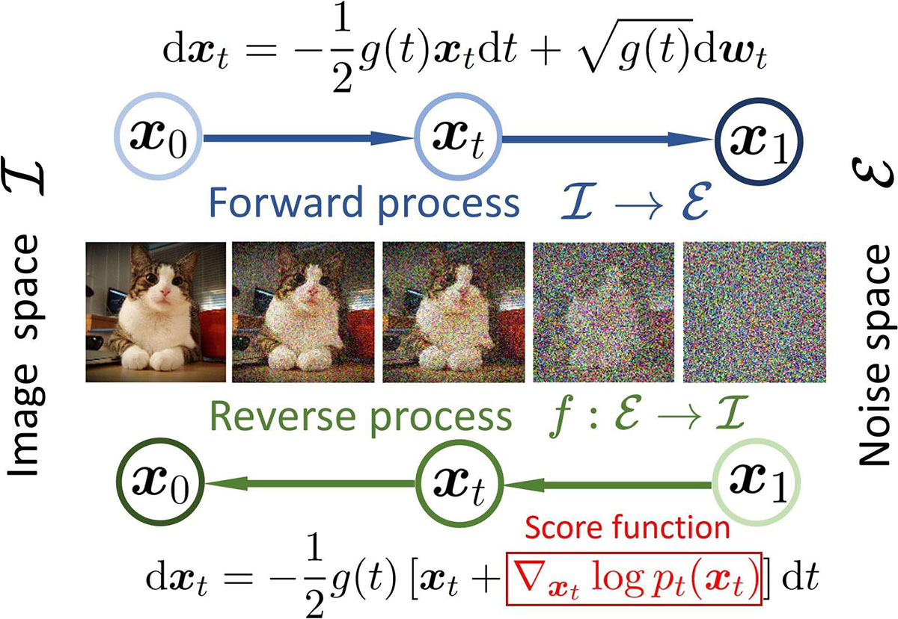

---
puppeteer:
  displayHeaderFooter: true
  headerTemplate: '<div style="font-size: 10px; margin: 0 auto;">第四章：多模態影像生成原理與視覺屬性提示實戰</div>'
  footerTemplate: '<div style="font-size: 10px; margin: 0 auto;">第 <span class="pageNumber"></span> 頁 / 共 <span class="totalPages"></span> 頁</div>'
  margin:
    top: "1.5cm"
    bottom: "1.5cm"
    left: "1.5cm"
    right: "1.5cm"
---
<style>
  /* 全域字型、字級與行距 */
  body {
    font-size: 16pt !important;
    line-height: 1.7 !important;
    font-family: "Microsoft JhengHei", "PingFang TC", "Helvetica Neue", sans-serif;
  }

  /* 階層標題微調 */
  h1 { font-size: 28pt !important; margin-bottom: 0.5em !important; }
  h2 { font-size: 22pt !important; page-break-before: always; }
  h3 { font-size: 18pt !important; }
  h4 { font-size: 15pt !important; }

  /* 表格文字與排版優化 (防 PDF 溢出) */
  table {
    width: 100% !important;
    max-width: 100% !important;
    table-layout: fixed !important;
    border-collapse: collapse !important;
    box-sizing: border-box !important;
    margin: 1.2em 0 !important;
    page-break-inside: auto !important;
  }

  thead {
    display: table-header-group !important;
  }

  tr {
    page-break-inside: avoid !important;
  }

  th, td {
    font-size: 11pt !important;
    line-height: 1.45 !important;
    padding: 6px 8px !important;
    border: 1px solid #d0d7de !important;
    vertical-align: top !important;
    word-wrap: break-word !important;
    word-break: break-word !important;
    overflow-wrap: anywhere !important;
    white-space: normal !important;
  }

  th {
    background-color: #f6f8fa !important;
    font-weight: bold !important;
    text-align: left !important;
  }

  /* 智慧欄寬配比 */
  /* 2 欄表格 (例如：實作單) */
  table tr > th:first-child:nth-last-child(2),
  table tr > td:first-child:nth-last-child(2) {
    width: 28% !important;
  }
  table tr > th:nth-child(2):nth-last-child(1),
  table tr > td:nth-child(2):nth-last-child(1) {
    width: 72% !important;
  }

  /* 3 欄表格 */
  table tr > th:first-child:nth-last-child(3),
  table tr > td:first-child:nth-last-child(3) {
    width: 22% !important;
  }
  table tr > th:nth-child(2):nth-last-child(2),
  table tr > td:nth-child(2):nth-last-child(2) {
    width: 28% !important;
  }
  table tr > th:nth-child(3):nth-last-child(1),
  table tr > td:nth-child(3):nth-last-child(1) {
    width: 50% !important;
  }

  /* 4 欄表格 (模型詳細比較表) */
  table tr > th:first-child:nth-last-child(4),
  table tr > td:first-child:nth-last-child(4) {
    width: 22% !important;
  }
  table tr > th:nth-child(2):nth-last-child(3),
  table tr > td:nth-child(2):nth-last-child(3) {
    width: 26% !important;
  }
  table tr > th:nth-child(3):nth-last-child(2),
  table tr > td:nth-child(3):nth-last-child(2) {
    width: 26% !important;
  }
  table tr > th:nth-child(4):nth-last-child(1),
  table tr > td:nth-child(4):nth-last-child(1) {
    width: 26% !important;
  }

  /* 程式碼與提示詞區塊 (防 PDF 溢出) */
  pre {
    font-size: 11pt !important;
    line-height: 1.5 !important;
    font-family: Consolas, "Courier New", monospace !important;
    white-space: pre-wrap !important;
    word-wrap: break-word !important;
    word-break: break-word !important;
    overflow-wrap: anywhere !important;
    max-width: 100% !important;
    box-sizing: border-box !important;
    margin: 1em 0 !important;
    padding: 10px 14px !important;
    background-color: #f6f8fa !important;
    border: 1px solid #d0d7de !important;
    border-radius: 6px !important;
    page-break-inside: avoid !important;
  }

  pre code {
    font-size: 11pt !important;
    line-height: 1.5 !important;
    font-family: Consolas, "Courier New", monospace !important;
    white-space: pre-wrap !important;
    word-break: break-word !important;
    overflow-wrap: anywhere !important;
  }

  code:not(pre code) {
    font-size: 0.9em !important;
    font-family: Consolas, "Courier New", monospace !important;
    background-color: rgba(175, 184, 193, 0.2) !important;
    padding: 0.2em 0.4em !important;
    border-radius: 3px !important;
  }
</style>

# 第四章：多模態影像生成原理與視覺屬性提示實戰

在第三章中，我們深入探討了大型語言模型（LLM）的文字生成機制，並掌握了以語境工程為核心的 CRISP 結構化提示架構。然而，現代數位內容設計早已跨越純文字的藩籬。無論是社群媒體的視覺傳播、永續議題的公眾倡議，抑或是數位行銷的品牌塑造，高品質且具備強烈敘事力的「影像」，往往是抓住受眾眼球、引發情感共鳴的第一線載體。

本章將帶領同學們從「純文字提示」正式邁入「文字驅動影像生成」（Text-to-Image Generation）的多模態實戰領域。我們將揭開當代生成式影像技術背後的「擴散模型」（Diffusion Model）神祕面紗，解析如何透過結構化的視覺語彙精準控制畫面；更重要的是，我們將全面接軌專業創作者工作流平台——**Google Flow**，深入剖析其旗下的三大核心影像生成模型：**Nano Banana Pro**、**Nano Banana 2** 與 **Imagen 4**。透過理論解析、模型橫向評測與永續發展目標（SDGs）的視覺專題實作，你將學會如何將抽象的社會關懷與企劃概念，精準轉化為震撼人心的數位視覺資產。

---

## 4.1 擴散模型的生成邏輯：從雜訊中雕琢細節

許多初學者在接觸 AI 生圖時，常誤以為模型是像搜尋引擎一樣，從資料庫中把成千上萬張既有照片剪下、拼貼成一張新圖。這種錯誤的直覺往往導致使用者在下提示詞時產生挫折感，例如不斷質疑為什麼模型無法精準貼上某個特定商標，或者為什麼畫面中的光影與物理透視會產生奇異扭曲。

要真正駕馭現代影像生成工具，我們必須先建立正確的底層技術心智模型。

當前主流的文字生成影像模型（包括 Google 的 Imagen 系列與 Nano Banana 核心技術架構），大多建立在**擴散模型（Diffusion Model）**的原理之上。

擴散模型的訓練與生成過程，可以透過一個直觀的生活譬喻來理解：**「雕塑家從未經雕琢的大理石原石中鑿出神像」**。

1. **正向加噪過程（Forward Diffusion Process）**：在模型的訓練階段，科學家將一張張清晰無比的高解析度真實照片，逐步、按比例地加入微小的隨機高斯雜訊（Gaussian Noise）。隨著加噪步數不斷推進，原本清晰的影像逐漸變得模糊、顆粒化，直到最後徹底變成一片毫無規則、有如古老電視機收不到訊號時的「雪花雜訊圖」。
2. **反向去噪過程（Reverse Denoising Process）**：擴散神經網路的核心任務，就是學習「如何把雜訊一步步扣除」。在生成階段，模型接收到使用者輸入的一組文字提示（Prompt），它會從一個完全隨機生成的純雜訊起點開始，根據文字語意的指引，逐步預測每一步雜訊的形狀並將其剔除。經過數十個時間步（Timesteps）的反覆演算與雕琢，原本雜亂無章的雜訊逐漸浮現出物體的輪廓、明暗的交界、材質的紋理，最終還原出一張構圖完整、光影精緻的高畫質影像。



```text
【擴散模型生成影像的四階段演進】
階段一：初始隨機雜訊（如同電視雪花，由隨機雜訊種子 Seed 決定起點）
   ↓（反向去噪演算第 1~10 步：文字語意開始引導結構）
階段二：低頻巨觀幾何輪廓（出現明暗對比、天空與地平線分割、主體大致位置）
   ↓（反向去噪演算第 11~30 步：物件特徵成形）
階段三：中頻結構與姿態（主體邊緣銳化、人物肢體定位、陰影與透視落位）
   ↓（反向去噪演算第 31~50 步：微觀紋理渲染）
階段四：高頻細節與終端畫質（皮膚毛孔、布料纖維、水珠反光與真實環境光）
```

理解這個「去噪雕琢」的過程，對於我們控制生成結果至關重要：
* **隨機雜訊種子（Seed）**：每一個隨機雜訊起點都由一個數值（種子碼）所標記。只要提示詞相同、模型架構相同，且鎖定相同的種子碼，模型就能重現近乎相同的空間結構與主體特徵。反之，更換種子碼就會開啟完全不同的構圖佈局。
* **引導強度（Guidance Scale / CFG Scale）**：這代表模型在去噪過程中「聽從提示詞指示」的嚴格程度。數值適中時，畫面兼具提示詞要求與自然的視覺多樣性；數值過高時，模型會過度強迫畫面吻合每一個單詞，導致線條生硬或色彩過度飽和；數值過低時，模型則會忽視提示詞自由發揮。

---

## 4.2 影像提示詞的四層結構架構：S-S-L-M 控制維度

如果我們只對模型輸入「一張關心海洋環境的宣傳海報」，模型由於缺乏具體的視覺約束，只能依賴機率分佈隨機挑選常見元素，最後往往產出一張平庸且缺乏情緒張力的罐頭圖案。

專業的視覺提示工程，必須借鑑導演、攝影師與藝術總監的思考框架。我們將文字提示拆解為四大核心層級，統稱為 **S-S-L-M 提示架構**（Subject, Setting, Lighting, Medium）。透過模組化的屬性拆解，創作者能像調配色彩般精準掌控畫面的每一個細節。

### 4.2.1 主體與核心動態（Subject & Action）

主體是視覺敘事的靈魂焦點。許多初學者在下提示詞時，常寫出過於空泛抽象的單詞（例如只寫「一個人」或「一群志工」），這會迫使模型從龐大的機率庫中調用最常見、最缺乏特徵的大眾刻板印象，生成出眼神空洞、姿勢呆板的罐頭人物。

在專業的 S 維度工程中，我們需要精準界定以下四項屬性：
1. **身分外貌與年齡層**：明確年齡階段、身形輪廓、族裔特徵、面部歷練細節（如皺紋、雀斑或風霜感）。
2. **服飾剪裁與材質細節**：服裝風格、材質布料、磨損程度或專業裝備（如粗織麻布、油污工作服、高科技防水外套）。
3. **決定性動態（The Decisive Action）**：主角當下正在進行什麼動作？是緊繃施力、奔跑穿梭，還是沉靜專注？
4. **眼神與內在微表情**：視線的聚焦點、眉宇間的情緒（憂慮、堅毅、驚喜或沉思），這直接決定了畫面能否與觀眾產生情感共鳴。

> **多場景實戰範例**：
> * **範例 1（SDGs 14 海洋生態倡議）**：
>   * *空泛提示*：`A fisherman collecting garbage from the sea.`（一名漁夫在海裡撿垃圾）
>   * *S 維度精準提示*：`一位皮膚黝黑、眼角刻有深刻風霜皺紋的六十歲台灣老漁夫，身穿補丁斑駁的深藍色防水圍裙，雙手青筋暴露，正吃力且專注地從濁浪中拉起纏滿各色塑膠微粒與廢棄寶特瓶的殘破漁網，眼神透露出堅定與對海洋枯竭的深層憂慮。`
> * **範例 2（SDGs 4 優質教育／偏鄉科技）**：
>   * *空泛提示*：`Rural students studying science with solar panels.`（偏鄉學生用太陽能板學科學）
>   * *S 維度精準提示*：`兩位穿著洗舊灰色帆布校服的東南亞小學五年級學童（一男一女），正蹲在粗糙的木質課桌前，全神貫注地組裝一個以廢棄回收塑膠瓶製成的微型太陽能自走車。女孩手持小型螺絲起子固定軸承，男孩小心翼翼地調校微型光伏板的角度，兩人臉上洋溢著發現科學奧祕時純真燦爛的專注笑容。`
> * **範例 3（綠色商業設計／零碳美妝產品）**：
>   * *空泛提示*：`A bottle of organic cosmetics on a table.`（桌上的一瓶有機化妝品）
>   * *S 維度精準提示*：`一隻修長優雅、修剪整齊的女性手掌，手腕佩戴極簡霧面銀色纖細手鐲，正溫柔托起一瓶以甘蔗渣再生塑料與磨砂玻璃打造的極簡精華液瓶；瓶身凝結著微細露珠，金屬泵頭反射出細膩微光，展現崇尚自然、純淨無添加的肌膚保養哲學。`

### 4.2.2 場景與構圖視角（Setting & Composition）

如果主體是故事主角，場景與構圖就是構築世界的舞台。構圖不僅決定了畫面中各視覺元素的幾何關係與視線動線，更對於數位內容設計至關重要——它決定了是否為後續的專題文案、活動標題與 Logo 保留了**排版負空間（Negative Space）**。

在 S 維度（Setting）中，創作者必須精確設定：
1. **空間環境與景深層次**：前景、中景與遠景的地景特徵，環境中的地標物、自然氣候或建築構造。
2. **相機機位與拍攝角度**：低角度仰拍（Low-Angle Shot，賦予主角崇高感或壓迫感）、水平人眼視角（Eye-Level Shot，營造親切紀實感）、鳥瞰俯拍（Bird's-Eye View，展現客觀宏觀大局）。
3. **經典構圖法則**：三分法則（Rule of Thirds）、引導線構圖（Leading Lines）、中心對稱（Symmetrical Composition）或框架構圖（Frame in Frame）。
4. **版面排版負空間**：明確指出畫面的上方、左側或右側需保持純淨無干擾，為平面設計留白。

> **多場景實戰範例**：
> * **範例 1（SDGs 13 氣候變遷／乾旱地景海報）**：
>   * *構圖重點*：超廣角低角度仰拍，地平線壓低於畫面下方五分之一，前方是大面積乾涸龜裂的泥地紋理作為視覺引導線；畫面上方五分之四為空曠開闊的灰白色酷熱天空，刻意保留充足乾淨的負空間（Ample negative space in the upper area），以利後續排版宣傳主標題。
>   * *英文提示詞語彙*：`Low-angle extreme wide shot, cracked arid desert ground in the foreground creating leading lines, low horizon line at bottom fifth, vast empty minimalist heat-haze sky above, ample clean negative space in upper half for typography.`
> * **範例 2（現代智慧綠建築／對稱空間導引）**：
>   * *構圖重點*：鏡頭位於現代木構造綠建築天井中庭的正中心，採用嚴謹的單點透視對稱構圖（One-point perspective symmetry）。中央透水磚鋪面延伸至遠方，兩側為挑高四層樓、垂直垂掛原生藤蔓的室內綠化植生牆，營造莊嚴、和諧且充滿秩序感的空間張力。
>   * *英文提示詞語彙*：`Centered symmetrical composition, one-point perspective, modern sustainable timber atrium, four-story vertical green living walls framing the shot, porous brick pathway leading eye to the bright focal point in the distance.`
> * **範例 3（微觀生態／微距特寫與極淺景深）**：
>   * *構圖重點*：極端微距攝影（Extreme Macro Shot），將焦點嚴格鎖定於一枚剛由腐植土中破土而出的幼苗葉尖，光圈開至最大，前後景物均被極淺的景深（Shallow depth of field）化為夢幻迷離的翠綠色光斑散景，將觀者視線強制聚焦於葉片上直徑不到一毫米的清澈水滴。
>   * *英文提示詞語彙*：`Extreme macro close-up, razor-thin depth of field, sharp focus on a tiny water droplet on the tip of a green sprout, creamy soft bokeh background in blurred emerald green and soil tones, cinematic intimate framing.`

### 4.2.3 光影與色彩氛圍（Lighting & Color Mood）

光是攝影與視覺藝術的靈魂。在擴散模型的潛在空間中，提示詞對光線方向、光質硬度與色溫的描述，直接決定了整幅畫面的情緒基調（Emotional Tone）。

在 L 維度中，我們需要精準雕琢：
1. **光源種類與照射方向**：自然日照、窗邊漫射光、戲劇性側光（Side-rim lighting）、強烈逆光（Backlight）、金屬輪廓光（Rim light）或頂部聚光燈。
2. **光質軟硬度與對比等級**：直射烈日的硬光（Hard light，帶來銳利深黑陰影與緊張感） vs. 陰天陰霾的柔光（Soft diffused light，帶來平緩過渡與溫柔沉靜）。
3. **特定大氣光學效應**：丁達爾效應／耶穌光（Tyndall effect / Crepuscular rays）、薄霧散射（Hazy volumetric fog）、黃金時刻（Golden hour）或藍調時刻（Blue hour）。
4. **色彩體系與心理感受**：冷冽單色灰藍（傳遞疏離、危機或理性）、暖金琥珀色（傳遞希望、豐收與溫暖）、高飽和對比霓虹（賽博龐克／科技警戒）。

> **多場景實戰範例**：
> * **範例 1（希望願景與神聖感／黃金時刻丁達爾光束）**：
>   * *光影重點*：清晨破曉前的黃金時刻（Golden hour），初升朝陽斜射穿透薄霧與風力發電機葉片，形成壯麗神聖的丁達爾效應光柱（Dramatic sunbeams / God rays）。暖金色的晨曦撫過翠綠山丘，在露水上折射出耀眼高光，呈現充滿希望、潔淨與新生的視覺感染力。
>   * *英文提示詞語彙*：`Early morning golden hour lighting, dramatic Tyndall effect volumetric light beams piercing through morning mist, warm amber and honey tones, glittering dew highlights, soft radiant glow conveying hope and renewal.`
> * **範例 2（社會痛點紀實／倫勃朗光與冷調明暗對比）**：
>   * *光影重點*：古典明暗對照法（Chiaroscuro），整體處於低調子（Low-key）陰暗環境。左側一道未經修飾的冷白色側光切入，在人物臉頰形成經典的倫勃朗三角形光斑；陰影深邃厚重，背景完全隱沒在冷冽灰黑之中，強化孤獨、沉重與困境的心理壓迫感。
>   * *英文提示詞語彙*：`High-contrast Chiaroscuro lighting, dramatic Rembrandt lighting from the side, cool desolate blue-gray color palette, deep pitch-black shadows with rich texture, somber moody atmosphere.`
> * **範例 3（科技未來與環境對比／雙色溫光影）**：
>   * *光影重點*：雙色溫對比打光（Dual-tone lighting）。主體右側受冰冷刺眼的賽博青藍色（Cool cyan）螢幕光照射，象徵人工數位科技；左側則受到微弱而深沉的夕陽餘暉（Warm sunset orange）沐浴，象徵日漸式微的自然生態，冷暖雙色交融於主體邊緣，產生強烈戲劇張力。
>   * *英文提示詞語彙*：`Cinematic dual-tone lighting, split lighting with cold cyan neon light on one side and warm sunset tungsten amber on the other, sharp shadow transitions, stylized visual dichotomy.`

### 4.2.4 媒材與相機規格（Medium & Camera Specification）

M 維度決定了影像生成的「物理微觀質感」與「成像工藝風格」。如果不提供媒材限制，模型往往會默認產出介於 3D 遊戲 CG、塑膠玩具與磨皮照片之間的怪異混合體。透過指定相機系統、鏡頭焦段、膠卷型號或數位渲染器，我們能引導模型重現真實光學透鏡的物理瑕疵與藝術媒材的微觀肌理。

在 M 維度中，常用的風格控制手法包括：
1. **紀實與藝術媒材類別**：真實攝影（Photography）、扁平向量插畫（Flat Vector）、水彩渲染（Watercolor）、3D 產品渲染（3D Render）、孔版印刷（Risograph）。
2. **經典相機系統與感光元件規格**：全片幅單眼相機（35mm Full-Frame）、頂級中片幅相機（Hasselblad / Phase One Medium Format，具備極高動態範圍與細膩層次）、徠卡旁軸測距相機（Leica M System）。
3. **鏡頭光學特性與景深表現**：35mm 定焦鏡（街頭人文紀實經典焦段）、85mm f/1.4 大光圈人像鏡（柔美奶油散景）、100mm Macro 微距鏡（微觀毛孔與纖維纖毫畢現）。
4. **底片色調與渲染引擎質感**：Kodak Portra 400（自然溫潤的暖膚色調）、Kodak Tri-X 400（經典高對比黑白銀鹽顆粒）、Octane Render / Unreal Engine 5（高擬真 3D 物理光線追蹤）。

> **多場景實戰範例**：
> * **範例 1（國家地理級別／紀實新聞攝影規格）**：
>   * *媒材重點*：頂級紀實新聞攝影風格，模擬中片幅哈蘇相機搭配 35mm 廣角定焦鏡頭。微細膠卷顆粒感（Subtle film grain），邊緣過渡銳利自然，忠實保留皮膚毛孔紋理、織品纖維與真實環境雜訊，杜絕一切塑膠感與過度磨皮。
>   * *英文提示詞語彙*：`Authentic photojournalism style, shot on Hasselblad H6D-100c with 35mm lens, f/2.8, raw unedited documentary photograph, subtle analog film grain, micro-textures on skin and fabric, National Geographic aesthetic, no CGI, no smooth plastic skin.`
> * **範例 2（工業設計與永續概念提案／Octane 3D 物理渲染）**：
>   * *媒材重點*：高階 3D 工業產品概念渲染圖，由 Cinema 4D 與 Octane Render 引擎運算。逼真的次表面散射（Subsurface Scattering），細膩呈現半透明磨砂生物樹脂、霧面壓克力與霧面再生金屬的微觀折射，工作室無影柔光箱打光。
>   * *英文提示詞語彙*：`3D concept product render, Octane Render, Cinema 4D, photorealistic ray tracing, realistic subsurface scattering, frosted matte biodegradable resin and brushed aluminum texture, clean studio lighting, 8k resolution industrial design.`
> * **範例 3（青年社群與倡議手冊／現代扁平向量與孔版印刷質感）**：
>   * *媒材重點*：現代極簡向量插畫風格（Modern flat vector illustration），搭配 Risograph 孔版印刷的微細網點與復古油墨疊印質感。乾淨的幾何輪廓、Pantone 莫蘭迪大地色塊，適合手冊封面、文創周邊與社群圖文懶人包。
>   * *英文提示詞語彙*：`Modern flat vector illustration, minimalist geometric graphic design, Risograph print texture with subtle halftone dots, organic earthy Pantone color palette, clean vector lines, retro-modern editorial poster art style.`

### 4.2.5 課堂 3 分鐘思考題

> **思考情境**：
> 某組同學在進行「SDGs 12 責任消費與生產：快時尚衣物氾濫」的視覺創作時，輸入了提示詞：`一堆被丟棄的舊衣服，非常具有說服力，非常美麗，8K，高畫質`。
> 結果生成出來的影像看起來像是在乾淨精品店倉庫裡擺放整齊的衣服展示，完全失去了批判與警示的震撼力。
> 
> **請分析**：
> 1. 原提示詞中出現了哪些毫無實質控制力且容易混淆模型的無效贅詞？
> 2. 請試著運用 S-S-L-M 四層結構，為該組重新架構提示詞的重點描述方向。

---

## 4.3 實務專題工作坊：從 CRISP 文案到視覺資產產製

現在，我們將正式把第三章學會的語言模型提示工程，與本章的多模態生圖工具完整串接。

在數位行銷或社會倡議專案中，最高效的工作流絕不是盲目地直接向生圖軟體下指令，而是遵循以下標準三步驟作業程序：

```text
【跨模態內容產製標準工作流（CRISP-to-Flow Workflow）】
4.3.1 步驟 1：運用 CRISP 產出視覺敘事腳本（在 Google AI Studio 中完成 S-S-L-M 提示詞）
   ↓
4.3.2 步驟 2：於 Google AI Studio 中使用 Nano Banana 2 Lite 進行視覺生成（秒級原型驗證與 A/B 測試）
   ↓
4.3.3 步驟 3：從原型到高品質成品——將滿意提示詞與圖片應用於 Google Flow（以圖生圖錨定與 Inpainting 精修）
```

在以下實作中，我們以「SDGs 14 保育海洋生態」為核心主題，目標是產出一張具有強烈心靈震懾力、揭露微塑膠與廢棄漁網殘害海洋物種的紀實攝影視覺，並依循以下三個獨立小節逐步實踐完整工作流。

### 4.3.1 步驟 1：運用 CRISP 產出視覺敘事腳本（在 Google AI Studio 中執行）

在將提示詞送入生圖軟體前，我們首先登入專業級開發環境 **Google AI Studio**（[aistudio.google.com](https://aistudio.google.com)），藉由大型語言模型的語意推理與語境工程，將抽象的 SDGs 議題轉化為具備高視覺衝擊力的結構化提示詞。

#### 1. Google AI Studio 介面參數設定指引

在 Google AI Studio 控制台中，建議進行以下核心參數配置：
* **System Instructions（系統指令）**：
  > `你是一位兼具世界新聞攝影獎（World Press Photo）得主視野的資深生態紀實攝影師，同時也是精通多模態生成影像的專業提示工程專家。你的任務是將永續發展與社會議題企劃，精確拆解為 S-S-L-M 四層視覺控制維度，並轉化為專供 Nano Banana 2 Lite 進行快速概念迭代的高品質中文正向提示詞。`
* **Temperature（溫度值）**：設定為 **`0.7`**。在提供充足創意發想與視覺細節想像力的同時，穩定維持 S-S-L-M 框架與標籤格式，避免隨機發散。
* **Top-P（核取樣）**：設定為 **`0.9`** 或 **`0.95`**。保留光學相機參數、海洋微觀物理現象與生態專有名詞的豐富度。

#### 2. CRISP 提示詞架構（融合 S-S-L-M 規範與 Few-shot 示範）

在使用者提示詞輸入框中，輸入以下結合 S-S-L-M 架構解析、Few-shot 示範並指定生成 3 組提案至 Nano Banana 2 Lite 的 CRISP 提示詞：

```text
【角色 Context】
你是一位兼具世界新聞攝影獎（World Press Photo）得主視野的資深生態紀實攝影師，同時也是精通多模態生圖模型的提示工程專家。

【任務 Request】
請為「SDGs 14 保育海洋生態：幽靈漁網與海洋廢棄物危機」構思 3 組具備不同敘事切角與鏡頭視角的畫面提案。每組提案均須嚴格依循「S-S-L-M」架構進行深度拆解，並各輸出一段專為輕量生圖模型「Nano Banana 2 Lite」優化的高品質中文正向提示詞，供創作者進行多方案快速概念驗證。

【資訊 Information】
* 核心議題：聚焦於殘留於海洋深處的「幽靈漁網」（Ghost Nets）與懸浮微塑膠，對海洋生物造成的窒息與纏繞威脅。
* 3 組視角規劃建議：
  - 提案 A（生物受困特寫）：年幼海龜受困於破舊綠色尼龍漁網，強調眼神無助與人造廢棄物的殘酷。
  - 提案 B（宏觀生態摧毀）：深海珊瑚礁群落被沉積巨型漁網籠罩覆蓋，展現大範圍生態浩劫的宏觀視角。
  - 提案 C（微觀污染光影）：海面透光處飄散無數微塑膠碎屑顆粒，呈現如暴風雪般無所不在的隱形危機。

【規範 Specifics】
在拆解畫面時，必須完整導入「S-S-L-M」四層控制維度：
1. S (Subject & Action - 主體與核心動態)：明確定義角色身分、年齡體型、受困動態、肢體姿態與微表情神態。
2. S (Setting & Composition - 場景與構圖視角)：精準描述水下環境深度、視角高度（如低角度仰拍）、景深層次，並刻意預留排版負空間（Negative Space）。
3. L (Lighting & Color Mood - 光影與色彩氛圍)：指定光源性質（如穿透水面的丁達爾光束 Tyndall rays）、明暗對比（Chiaroscuro）與冷冽灰藍/濁綠色彩心理。
4. M (Medium & Camera Specification - 媒材與相機規格)：設定專業水下相機型號、鏡頭焦段、微細顆粒感與真實光學質感，確保適配 Nano Banana 2 Lite 的寫實成像特性，杜絕塑膠感。

【範例 Few-shot Demonstration】
請參考以下成功轉化範例之輸出格式與精確度：

[範例輸入]
議題：SDGs 15 陸域生態——熱帶雨林盜伐與瀕危動物棲地喪失

[範例輸出]
* 提案名稱：焦土邊緣的守望
* S-S-L-M 結構拆解：
  - S（主體動態）：一隻眼神充滿驚恐與疲憊的成年母紅毛猩猩，緊抱著懷中幼崽，蜷縮在一根巨大焦黑倒木上，粗糙毛髮上沾染泥濘與灰燼。
  - S（場景構圖）：背景為大片被夷平的雨林焦土與遠方怪手濃煙。廣角三分法構圖，主角置於右側，左上方廣闊天空留白作為排版負空間。
  - L（光影氛圍）：濃煙遮蔽日光的低反差陰霾光，背後滲透出一道血橙色日落逆光，勾勒出猩猩毛髮邊緣輪廓光。
  - M（媒材相機）：Shot on Sony A7R V with 35mm f/1.8 lens, raw photojournalism style, subtle analog film grain, micro-textures, no CGI plastic skin.
* Nano Banana 2 Lite 中文提示詞：
  "一張令人心碎的紀實新聞攝影照片：一隻成年母紅毛猩猩在焦黑倒木上緊緊抱著懷中的小猩猩。紅毛猩猩眼神充滿痛苦與悲傷，粗糙的橘紅毛髮上沾滿泥濘與焦炭黑灰。背景是觸目驚心、被夷為平地的雨林焦土，遠方重型怪手在濃煙中若隱若現。廣角三分法則構圖，充滿戲劇性的煙霧暮光逆光，勾勒出微弱的琥珀金邊緣輪廓光。Sony A7R V 拍攝，35mm 定焦鏡頭，真實新聞報導攝影美學，微觀毛孔與纖維細節，無 3D 渲染，無塑膠感皮膚。"
```

### 4.3.2 步驟 2：於 Google AI Studio 中使用 Nano Banana 2 Lite 進行視覺生成

在 Google AI Studio 產出 S-S-L-M 敘事腳本後，我們直接在 **Google AI Studio** 環境中選用輕量高效率的生成引擎 **Nano Banana 2 Lite** 進行秒級的原型視覺渲染與概念驗證。

#### 1. Google AI Studio（Nano Banana 2 Lite）生圖參數設定指引

在 Google AI Studio 控制台中，建議配置以下核心生圖參數：
* **System Instructions（系統指令）**：
  > `你是一個高精度的真實光學與自然生態影像生成引擎。請忠實渲染提示詞中所描述的 S-S-L-M 結構細節，嚴格呈現真實世界的物理光學、相機景深與微觀材質肌理；畫面全面杜絕任何不自然的平滑塑膠感、3D 動畫卡通渲染、肢體扭曲變形與解剖結構錯誤。`
* **Temperature（溫度值）**：設定為 **`0.5`**。在影像生成階段，適度降低溫度有助於模型精確收斂於提示詞中的構圖、光影與相機規格要求，大幅降低畫面產生肢體畸形或多餘元素的機率。
* **Top-P（核取樣）**：設定為 **`0.85`**。收斂取樣空間至高品質的光學紋理與自然特徵，確保畫面邊緣清晰銳利。
* **Output Aspect（輸出長寬比）**：設定為 **`4:5`**（垂直社群媒體發布、專題倡議海報與電子看板的標準黃金比例）。

#### 2. 結構化提示詞（已融入負向排除條件）

創作者可直接複製以下 3 組兼具 S-S-L-M 深度與負向品質控制的中文提示詞，貼入 Google AI Studio 執行即時生成：

##### 提案一（主測方案：幼龜受困特寫）
```text
一張震撼人心的水下生態紀實攝影：一隻年幼的綠蠵龜在幽靈般風化殘破的綠色尼龍漁網中痛苦纏繞。海龜的龜甲帶著風霜粗糙的紋理，眼神充滿哀求，倒映著穿透海面的微弱陽光。四周海水充斥著微小的懸浮塑膠微粒，在陽光下折射出微光。低角度仰拍，視線望向波光粼粼的水面。丁達爾效應光芒穿透深邃的綠松石色海水，在海龜前肢勾勒出強烈的戲劇性高光，下方伴隨著凝重的深邃陰影。哈蘇 H6D-100c 搭配專業防水殼與 28mm 廣角鏡頭拍攝，龜甲角質與皮膚鱗片微觀細節纖毫畢現，微距水泡質感，國家地理雜誌紀實攝影美學。畫面杜絕 3D 動畫卡通感、塑膠平滑皮膚、多餘鰭肢或雙頭畸形，無人造乾淨泳池水質感，無不自然螢光色與低解析度模糊瑕疵。
```

##### 提案二（備選方案：珊瑚礁浩劫宏觀視角）
```text
廣角水下紀實攝影：一片原本生機盎然但正嚴重白化的巨大珊瑚礁群落，被一張廢棄的巨型幽靈漁網完全覆蓋、窒息絞殺。受驚的熱帶魚群被困在腐朽的尼龍網目中動彈不得。畫面採用中央廣角構圖，纏繞的粗重繩索化作延伸至深海深淵的強烈視覺引導線。大氣感低調暗藍色光影，微弱的陽光逐漸消失在渾濁的深海之中，營造冷冽而沉痛的氛圍。Sony A7R V 搭配 16-35mm 超廣角水下鏡頭拍攝，原始新聞攝影質感，強烈的明暗對比陰影，真實生態浩劫紀實風格。畫面杜絕電玩 CG 渲染、虛假水下光效、魚群形體變形、高飽和塑料感，杜絕畫面模糊與文字浮水印。
```

##### 提案三（備選方案：微塑膠風暴光影折射）
```text
極具戲劇張力的水下微距特寫攝影：無數發光的微塑膠顆粒與合成纖維碎屑如暴風雪般在幽暗的海水中密密麻麻地懸浮飄散。朦朧的遠景背景中，隱約浮現一隻孤獨野生物種海豚的模糊剪影。極淺景深精準對焦於前景折射出刺目光芒的五彩塑膠碎片上。強烈方向性的側光切穿幽暗海水，丁達爾體積光效應，高對比明暗層次，科研紀實攝影寫實質感，85mm 微距鏡頭成像美學，細微類比底片顆粒感。畫面杜絕 3D 向量插畫風、平滑塑膠球體、畫面過度曝光死白、非自然彩色噪點與像素顆粒瑕疵。
```

### 4.3.3 步驟 3：從原型到高品質成品——將滿意提示詞與圖片應用於 Google Flow（Nano Banana 2）

在 4.3.1 與 4.3.2 中，我們透過 Google AI Studio 與 Nano Banana 2 Lite 進行了腳本構思與快速的低延遲概念發想，並成功篩選出團隊一致認為最具衝擊力與情感共鳴的視覺雛形——**提案一（幼龜受困特寫）**。

然而，Nano Banana 2 Lite 的設計定位為「秒級原型驗證與靈感碰撞」，其成圖在邊緣銳利度、微觀材質豐富度，以及後續排版編輯的彈性上仍有侷限。若要將這張滿意的原型提升為能用於專題期末展覽、倡議海報印刷或官方社群的高品質主視覺，我們需要將資產移轉至專業創作者工作流平台——**Google Flow**，使用具備原生局部重繪與高精迭代能力的 **Nano Banana 2** 進行高品質升級。

---

#### 1. 如何將 Nano Banana 2 Lite 的圖片應用於 Google Flow（Nano Banana 2）

1. **圖片應用（以圖生圖 Image-to-Image / 參考圖錨定）**：
   * 將在 Google AI Studio 由 Nano Banana 2 Lite 生成滿意的「提案一（幼龜受困特寫）」圖檔下載至本地電腦。
   * 在 Google Flow 介面中切換至 **Nano Banana 2** 模型，將該圖片拖曳至「Image Reference（參考圖）」欄位中。
   * 將重繪強度（Denoising Strength / Variation Strength）設定在 **`0.4 ~ 0.5`**。這樣能確保模型嚴格繼承原草圖中海龜的頭部姿態、背甲受困角度與水下透視景深，同時由 Nano Banana 2 重新計算光影次表面散射與水珠微觀紋理。
2. **局部修復（Interactive Inpainting 筆刷遮罩）**：
   * 啟用 Google Flow 畫布上的筆刷工具（Brush / Mask Magic），塗抹原圖中不滿意的局部區域（例如：受困漁網的尼龍纖維不夠清晰，或是背景水中的微塑膠顆粒分布不夠均勻）。
   * 在局部提示詞中針對該區域進行精確補充，例如指定「增強水下殘破尼龍網線的風化纖維質感與微流水泡」，Nano Banana 2 便能在完全不動及主體海龜的前提下，完成無縫的高畫質局部替換。

#### 2. 模型工作流升級效益對照表

為了幫助同學們在實作專題中理清「快速原型」與「高精精修」的分工，下表梳理了兩個階段的協同效益：

| 評估維度 | Nano Banana 2 Lite（AI Studio 階段） | Nano Banana 2（Google Flow 階段） |
| :--- | :--- | :--- |
| **工作流定位** | **快速概念驗證（Prototyping）** | **精細修圖與高階迭代（Refinement）** |
| **圖片應用機制** | 純文字生圖（Text-to-Image） | **以圖生圖（Image-to-Image）＋筆刷局部遮罩（Inpainting）** |
| **提示詞形式** | 中文自然語言（快速碰撞靈感） | 中文/英文結構化提示詞（自然語言融入排除條件） |
| **負向控制方式** | 自然語言融入提示詞末尾 | 自然語言融入提示詞末尾（UI 無獨立負向欄位） |
| **生成速度與算力** | 次秒級極速回饋，輕量運算 | 秒級快速生成，提供深層光影與次表面散射運算 |
| **終端交付物** | 概念草圖、組內討論提案、A/B 構圖測試 | 社群平台高清貼文、修正瑕疵後的最終主視覺成圖 |

---

## 4.4 實作檢核表與常見誤區解析

在進行多模態影像生成時，許多初學者容易陷入一些常見的操作迷思。以下整理了常見問題的診斷對策：

### 4.4.1 常見操作誤區與除錯指引

1. **迷思一：提示詞塞滿了「8K, Masterpiece, Photorealistic, Extremely Detailed」**
   * **問題本質**：在早期的開源社群模型中，這些所謂的「畫質魔咒」可能有用；但在 Imagen 4 與 Nano Banana 體系中，這些詞彙屬於資訊量極低的冗餘雜訊，甚至會干擾模型對畫面核心主題的語意權重分配。
   * **改善對策**：刪除所有空洞的形容詞，改用「具體的相機型號（如 Sony A7R V）」、「精確的光圈景深（如 85mm f/1.4）」或「明確的材質物理描述（如 weathered cracked leather texture）」。
2. **迷思二：在畫面中放入過多相互衝突的主體與動態**
   * **問題本質**：例如同時要求「三隻正在奔跑的老虎、天空有兩架飛機、背景有城堡、湖裡有潛水艇」。擴散模型在去噪時會產生語意混合（Semantic Bleeding），導致老虎長出飛機機翼或水面浮現城堡磚瓦。
   * **改善對策**：堅守「單一焦點原則」。一張成功的視覺只傳遞一個核心故事，其餘背景元素均應作為烘托主體的次要環境。
3. **迷思三：忽視「排版留白空間」（Negative Space）的重要性**
   * **問題本質**：把畫面從左到右、從上到下填滿了繁複的細節，導致後續進入 Canva 或 Photoshop 想要壓上專題標題、副標題與組員名單時，找不到任何可以清晰閱讀文字的乾淨區域。
   * **改善對策**：在 S-S-L-M 的場景構圖（Setting & Composition）維度中，明確指示 `ample clean negative space in the upper left corner` 或 `clean minimalist solid background on the right side`。

### 4.4.2 本章實作檢核清單（Checklist）

完成本週的學習與實作任務後，請同學們對照以下清單自我檢核：

- [ ] **觀念理解**：能以自己的話向非技術背景同學解釋擴散模型「正向加噪」與「反向去噪雕琢」的運作邏輯。
- [ ] **架構掌握**：撰寫視覺提示詞時，能夠自覺拆解出 S-S-L-M（主體、場景構圖、光影氛圍、媒材規格）四大維度。
- [ ] **工具決策**：能清楚說明 Nano Banana 2 Lite（AI Studio 秒級原型驗證與靈感碰撞）與 Google Flow Nano Banana 2（以圖生圖高精升級與筆刷局部修復）的分工定位與協同效益。
- [ ] **負向控制**：能在無獨立負向提示詞欄位的介面中，以自然語言在提示詞尾端流暢融入排除條件（如杜絕塑膠感、多餘肢體、失真模糊）。
- [ ] **專案連結**：已為自身團隊所選定的 SDGs 專題議題，透過 AI Studio 產出概念原型草圖，並成功在 Google Flow 運用以圖生圖與 Inpainting 局部修復產出高品質期末主視覺成圖。

---

## 4.5 實作工作紙：SDGs 專題核心主視覺生成與模型調校

本工作單為本週實習評量項目，對應產出之正式 Word 檔案為 **`SDGs_專題核心主視覺生成與模型調校實作單.docx`**。請各組選定組別研究的 SDGs 永續議題，完成以下生成實驗並記錄於專案企劃書中：

| 評估階段與項目 | 實驗記錄與設定內容 |
| :--- | :--- |
| **專案組別與鎖定之 SDGs 議題** | 第 ______ 組 ｜ SDGs 目標編號與名稱：________________________ |
| **視覺溝通核心概念** | 本視覺欲傳達給大眾的核心痛點或未來願景一句話總結：<br>____________________________________________________ |
| **階段一：AI Studio (CRISP 視覺腳本)** | **Temperature**：0.7 ｜ **Top-P**：0.95<br>**System Instructions**：設定為永續視覺敘事與提示架構師專家角色。<br>**S-S-L-M 拆解**：主體（S）、場景構圖（S）、光影色彩（L）、媒材規格（M）。 |
| **階段二：Nano Banana 2 Lite 原型驗證** | **測試之 3 組切角提案**：提案一（微觀特寫）/ 提案二（宏觀浩劫）/ 提案三（象徵意象）<br>**團隊選定主測提案**：□ 提案一　□ 提案二　□ 提案三<br>**Aspect Ratio**：□ 4:5　□ 16:9　□ 1:1 ｜ **排除瑕疵句**：嵌入提示詞末尾 |
| **階段三：Google Flow (Nano Banana 2 精修)** | **以圖生圖 (Image Reference)**：載入 Lite 滿意草圖，重繪強度設為 `0.4 ~ 0.5`<br>**筆刷局部修復 (Interactive Inpainting)**：塗抹修復區域與修復提示詞<br>**最終整合提示詞**：完整 S-S-L-M 描述與自然語言排除條件句 |
| **迭代調校過程反思（至少兩次版本）** | 第一次生成發現之缺陷與提示詞修正：__________________________<br>第二次精修 (Inpainting/參數調校) 之成效：____________________ |
| **課堂即時諮詢與審查回饋欄** | □ 審核通過　□ 建議微調　□ 重新調校<br>教師/助教指導意見與簽章：________________________________ |

---

## 本章小結與下週預告

本章我們完成了從「純文字提示工程」到「多模態影像生成」的關鍵躍遷。我們不僅理解了擴散模型如同雕塑家般從雜訊中提取影像的物理直覺，更建構了 S-S-L-M 這一套跨越專業攝影與生成式設計的共通語彙。透過對 Google Flow 旗下 Nano Banana Pro、Nano Banana 2 與 Imagen 4 的全方位實戰評測，同學們已具備了為不同內容產製階段（從秒級概念發想、寫實痛點紀實，到高階海報圖文排版）精準配置模型資源的專業決策能力。

在掌握了視覺資產生成的強大能力後，下一個迫切的問題隨之浮現：**「我們如何確保所設計的內容與倡議論點，具備扎實的研究文獻支持，而非流於空泛的想像？」**

在**第五章**中，我們將跨入知識管理與文獻探勘的新境界——**「NotebookLM 專題文獻爬梳與多模態知識庫構建」**。同學們將學習如何利用 Grounding 技術錨定聯合國與學術智庫的權威報告，打造不產生幻覺的專屬 AI 研究助手，並將學術文獻快速轉化為引人入勝的播客語音（Audio Overview）與多模態企劃綱要，敬請期待！
