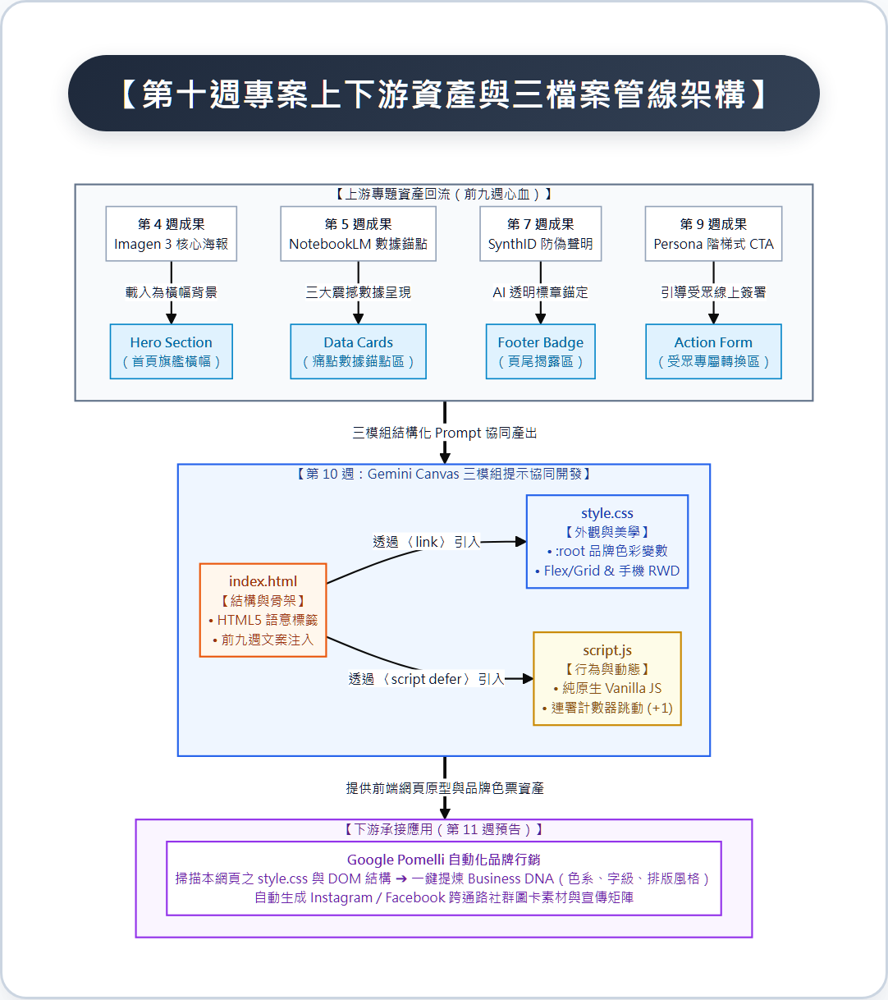
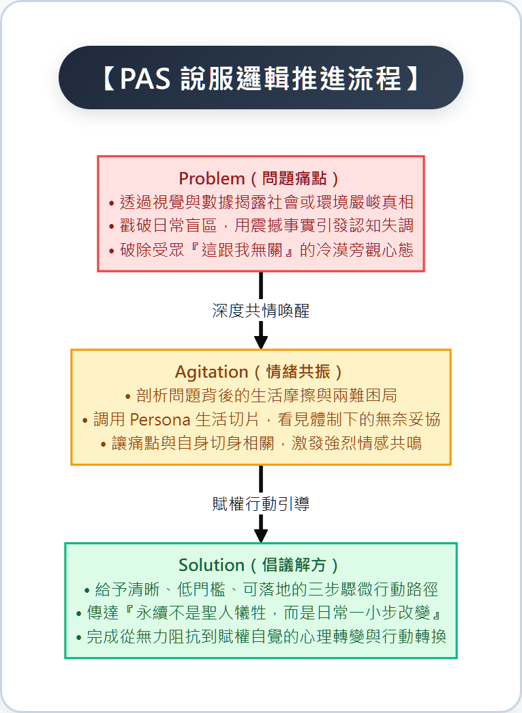
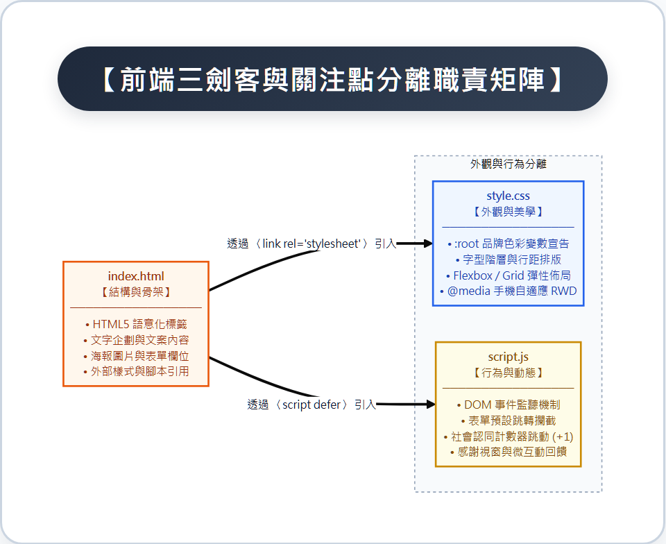
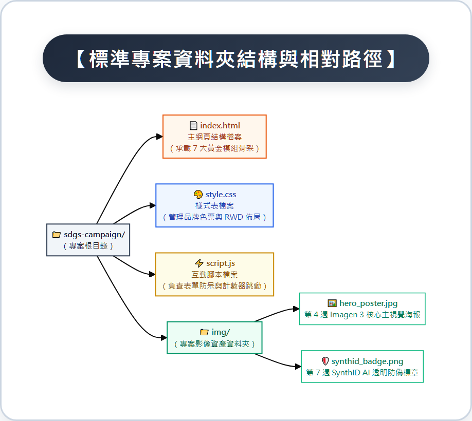
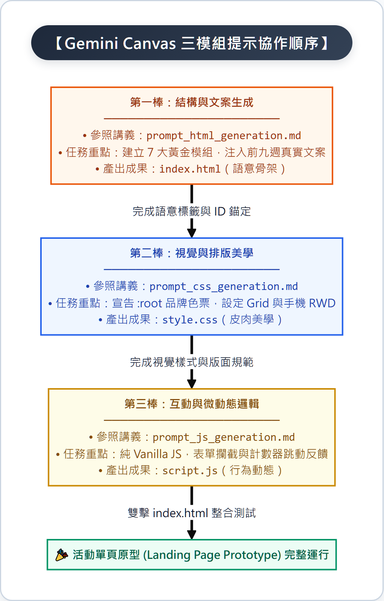
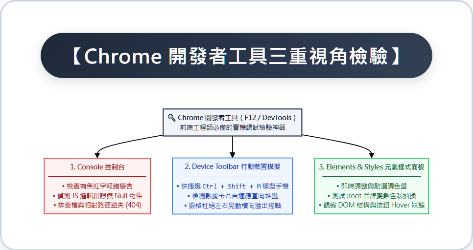
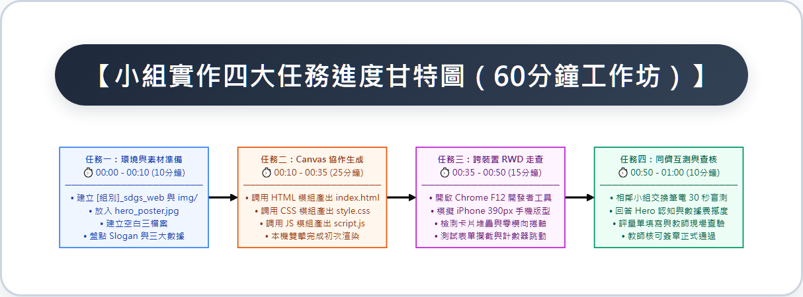

---
puppeteer:
  displayHeaderFooter: true
  headerTemplate: '<div style="font-size: 10px; margin: 0 auto;">第十週：活動網頁原型生成與資訊架構（HTML/CSS/JS 三檔案開發）</div>'
  footerTemplate: '<div style="font-size: 10px; margin: 0 auto;">第 <span class="pageNumber"></span> 頁 / 共 <span class="totalPages"></span> 頁</div>'
  margin:
    top: "1.5cm"
    bottom: "1.5cm"
    left: "1.5cm"
    right: "1.5cm"
---
<style>
  /* 全域字型、字級與行距 */
  body {
    font-size: 16pt !important;
    line-height: 1.7 !important;
    font-family: "Microsoft JhengHei", "PingFang TC", "Helvetica Neue", sans-serif;
  }

  /* 階層標題微調 */
  h1 { font-size: 28pt !important; margin-bottom: 0.5em !important; }
  h2 { font-size: 22pt !important; page-break-before: always; }
  h3 { font-size: 18pt !important; }
  h4 { font-size: 15pt !important; }

  /* 表格文字與排版優化 (防 PDF 溢出) */
  table {
    width: 100% !important;
    max-width: 100% !important;
    table-layout: fixed !important;
    border-collapse: collapse !important;
    box-sizing: border-box !important;
    margin: 1.2em 0 !important;
    page-break-inside: auto !important;
  }

  thead {
    display: table-header-group !important;
  }

  tr {
    page-break-inside: avoid !important;
  }

  th, td {
    font-size: 11pt !important;
    line-height: 1.45 !important;
    padding: 6px 8px !important;
    border: 1px solid #d0d7de !important;
    vertical-align: top !important;
    word-wrap: break-word !important;
    word-break: break-word !important;
    overflow-wrap: anywhere !important;
    white-space: normal !important;
  }

  th {
    background-color: #f6f8fa !important;
    font-weight: bold !important;
    text-align: left !important;
  }

  /* 智慧欄寬配比 */
  /* 2 欄表格 (例如：實作單) */
  table tr > th:first-child:nth-last-child(2),
  table tr > td:first-child:nth-last-child(2) {
    width: 28% !important;
  }
  table tr > th:nth-child(2):nth-last-child(1),
  table tr > td:nth-child(2):nth-last-child(1) {
    width: 72% !important;
  }

  /* 3 欄表格 */
  table tr > th:first-child:nth-last-child(3),
  table tr > td:first-child:nth-last-child(3) {
    width: 22% !important;
  }
  table tr > th:nth-child(2):nth-last-child(2),
  table tr > td:nth-child(2):nth-last-child(2) {
    width: 28% !important;
  }
  table tr > th:nth-child(3):nth-last-child(1),
  table tr > td:nth-child(3):nth-last-child(1) {
    width: 50% !important;
  }

  /* 4 欄表格 */
  table tr > th:first-child:nth-last-child(4),
  table tr > td:first-child:nth-last-child(4) {
    width: 18% !important;
  }
  table tr > th:nth-child(2):nth-last-child(3),
  table tr > td:nth-child(2):nth-last-child(3) {
    width: 26% !important;
  }
  table tr > th:nth-child(3):nth-last-child(2),
  table tr > td:nth-child(3):nth-last-child(2) {
    width: 28% !important;
  }
  table tr > th:nth-child(4):nth-last-child(1),
  table tr > td:nth-child(4):nth-last-child(1) {
    width: 28% !important;
  }

  /* 程式碼與提示詞區塊 (防 PDF 溢出) */
  pre {
    font-size: 11pt !important;
    line-height: 1.5 !important;
    font-family: Consolas, "Courier New", monospace !important;
    white-space: pre-wrap !important;
    word-wrap: break-word !important;
    word-break: break-word !important;
    overflow-wrap: anywhere !important;
    max-width: 100% !important;
    box-sizing: border-box !important;
    margin: 1em 0 !important;
    padding: 10px 14px !important;
    background-color: #f6f8fa !important;
    border: 1px solid #d0d7de !important;
    border-radius: 6px !important;
    page-break-inside: avoid !important;
  }

  pre code {
    font-size: 11pt !important;
    line-height: 1.5 !important;
    font-family: Consolas, "Courier New", monospace !important;
    white-space: pre-wrap !important;
    word-wrap: break-word !important;
    overflow-wrap: anywhere !important;
  }

  code:not(pre code) {
    font-size: 0.9em !important;
    font-family: Consolas, "Courier New", monospace !important;
    background-color: rgba(175, 184, 193, 0.2) !important;
    padding: 0.2em 0.4em !important;
    border-radius: 3px !important;
  }
</style>

# 第十週：活動網頁原型生成與資訊架構——從 PAS 說服邏輯、關注點分離到 Gemini Canvas 三檔案協同開發

## 課程導讀

在上一週（第 9 週）的課堂中，我們完成了專案中最具戰略意義的一步：從小組田野與社群留言中，運用 KJ 法（親和圖法）提煉出專案專屬的面向語意，塑造出有血有肉的立體 Persona（人物誌），並針對受眾的生活阻抗設計出階梯式行動呼籲（Call-to-Action, CTA）與可量化的 SMART 行銷目標。至此，各小組已經擁有一份兼具理性文獻、情感共鳴與執行步驟的正式企劃書。

然而，一份躺在 Word 檔案裡的企劃書，無論邏輯多麼縝密、文字多麼動人，對外在世界的受眾而言，依然只是靜止的構想。在數位時代，倡議如果不能被「看見、點擊、互動與體驗」，影響力就無法真正生根。

本週（第 10 週），我們迎來了全學期專題開發的第一個高潮里程碑——  **【活動網頁原型生成（含資訊架構與文案）】** 。我們將把第九週企劃書中的所有心血，轉化為能夠在瀏覽器中真實運行、支援手機與電腦螢幕的現代化  **活動單頁（One-Page Landing Page）** 。

對非資訊工程相關科系的大二同學而言，聽到「寫網頁、寫程式碼」往往會產生強烈的心理抗拒，擔心自己沒有資工背景、背不起繁複的語法。但請大家放心，在生成式人工智慧時代，前端開發的遊戲規則已經徹底改寫。我們不需要從零手刻每一行標籤，而是要學會扮演 **「前端產品經理與資訊架構師」** 的角色。

> **「在 AI 時代，最稀缺的不再是撰寫語法的雙手，而是梳理資訊架構（Information Architecture）的邏輯大腦、洞察受眾心理的同理心，以及與 AI 協同調校的精準對話能力！」**

為了讓網頁結構清晰、易於維護，並在實務上接軌業界標準，本週課堂我們將堅守現代前端開發最核心的黃金法則—— **「關注點分離（Separation of Concerns，SoC）」**。我們不會將所有代碼草率地擠在單一檔案中，而是會指引 **Google Gemini Canvas** 協同產出三個職責分明的獨立檔案：

1. **`index.html`（結構與內容）**：骨架語意化，乘載第 4 週核心海報、第 5 週權威數據、第 7 週 SynthID 揭露聲明與第 9 週文案。
2. **`style.css`（視覺風格與排版）**：皮肉美學，定義品牌色彩變數（`:root`）與行動裝置響應式排版（Mobile-First RWD），為第 11 週 Google Pomelli 自動提煉品牌 DNA 奠定基礎。
3. **`script.js`（行為與微互動）**：靈魂互動，實現平滑錨點滾動、承諾表單防呆攔截與連署計數器即時跳動反饋。



本週課堂同樣維持高節奏的 110 分鐘標準三段式結構：
- **第一階段（25分鐘）：** 核心理論講授——剖析活動網頁（Landing Page）說服邏輯、PAS 架構、7 大核心模組與「關注點分離」三檔案哲學。
- **第二階段（25分鐘）：** AI 工具操作示範——掌握 Gemini Canvas 多輪對話調校、三檔案 Prompt 模組拆解與 Chrome 開發者工具（F12）實機檢測技巧。
- **第三階段（60分鐘）：** PBL 小組實作——各組實機建立專案目錄、完成三檔案部署、執行跨裝置 RWD 走查，並進行課堂「同儕 3 分鐘情境體驗測試」與教師簽章查核。

---

## 第一節：活動網頁（Landing Page）資訊架構與前端三模組解構

### 1.1 什麼是專業的活動單頁（Landing Page）？與一般官方網站的本質差異

許多人在接到「做一個網頁」的任務時，腦海中浮現的往往是大學官網或跨國企業的品牌入口：頂部有十幾個下拉選單、左側有次級分類、頁面四處穿插著最新消息、校園地圖與行事曆。這種網站被稱為 **「資訊型官方網站（Corporate/Informational Website）」**，其核心目的在於「廣泛承載資訊、滿足多元訪客的查詢需求」，結構通常是龐大且網狀發散的。

然而，在數位行銷與社會倡議領域，面對專注力極為稀缺的現代社群大眾，資訊型官網的跳出率往往高達 80% 以上。當使用者滑過社群貼文、點擊連結進入頁面後，若在 5 秒內找不到重點，或者被眼花繚亂的選單分散注意力，就會毫不猶豫地關閉分頁。

因此，專業的數位內容行銷人員會採用 **「活動單頁（One-Page Landing Page，簡稱著陸頁或活動專頁）」**。活動網頁的本質不是「展示圖書館」，而是 **「鋪設一條單向直達的說服走廊」**。

| 比較維度 | 一般資訊型官方網站（Corporate Website） | 倡議型活動單頁（One-Page Landing Page） |
| :--- | :--- | :--- |
| **核心目標** | 品牌公關、組織介紹、多元資料庫檢索與日常公告 | 聚焦單一倡議議題，引導訪客完成特定轉換行為（Conversion） |
| **資訊架構** | 樹狀多層級、多頁面、多重跳轉導航選單 | 單一垂直頁面、線性敘事流動、單頁錨點滾動（One-page Scroll） |
| **視覺動線** | 發散式網狀瀏覽，訪客自由探索點擊 | 漏斗式向下聚焦，每一步皆為下一個行動做鋪墊 |
| **行動呼籲 (CTA)** | 多元且分散（查看詳情、下載年報、聯絡我們、登入會員） | 唯一且極致聚焦（簽署承諾、微行動測驗、領取實踐指南） |
| **注意力停留** | 停留時間分散，容易迷失於多層分頁中 | 專注於黃金 3 分鐘閱讀節奏，直擊痛點並完成轉換 |

活動單頁的核心價值在於 **「極致的轉換導向（Conversion-Oriented）」**。它不給受眾多餘的逃逸分岔路徑，而是透過嚴密的敘事節奏，牽引造訪者的心理狀態逐步推演。

---

### 1.2 高轉換說服骨架：PAS 說服框架與 SDGs 活動網頁 7 大黃金模組

要在短短數百個畫素的直向滾動空間內打動受眾，我們必須在資訊架構（Information Architecture，IA）中注入經典的行為心理學框架—— **PAS 說服框架**：



1. **Problem（問題痛點）：** 透過視覺與數據揭露社會或環境現象的嚴峻真相，破除「這跟我無關」的冷漠心態。
2. **Agitation（煽動共鳴）：** 剖析問題背後的生活摩擦，調用第 9 週 Persona 的生活切片，讓受眾看見自己在體制下的妥協與無奈，引發強烈的情緒共振。
3. **Solution（解方行動）：** 給予清晰、可落地的實踐路徑，讓受眾明白「永續不是聖人的犧牲，而是每個人跨出一小步就能創造的改變」，順理成章完成行動轉換。

基於 PAS 框架，一個專業的 SDGs 活動專題網頁，在資訊架構上應完整涵蓋以下 **7 大黃金核心模組**：

| 模組編號與名稱 | 對應 HTML 語意標籤 | 核心承載內容與前期專題資產回流 | 心理說服任務 |
| :--- | :--- | :--- | :--- |
| **1. 頂部導覽列**<br/>Navbar | `<nav id="navbar">` | 專案簡潔 Logo、章節快速錨點連結、右上角快捷微行動按鈕 | 建立專案信任感，提供清晰的單頁空間定位 |
| **2. 首頁旗艦橫幅**<br/>Hero Section | `<section id="hero">` | **第 4 週核心海報**作為主視覺、**第 9 週核心 Slogan**作為主標題、副標題與第一階微行動按鈕 | 抓住黃金 5 秒注意力，建立深刻第一印象 |
| **3. 痛點數據錨點區**<br/>Data Anchors | `<section id="problem">` | **第 5 週三大權威數據錨點**（震撼型、對比型、切身型大數字卡片化） | 戳破盲區，以客觀事實奠定議題權威說服力 |
| **4. 核心倡議解方**<br/>Core Solution | `<section id="solution">` | 拆解為「三步驟實踐路徑」，搭配圖文並茂的卡片說明 | 化繁為簡，消除受眾對永續倡議的繁瑣恐懼 |
| **5. 受眾專屬轉換區**<br/>Persona Action Zone | `<section id="action">` | 對接**第 9 週 Persona 心理阻抗**，配置線上簽署表單與第三階核心承諾 CTA 按鈕 | 引導訪客填寫姓名與身分，採取具體的承諾行動 |
| **6. 社會認同承諾牆**<br/>Social Proof | `<section id="social-proof">` | 動態累計簽署計數器（Counter）、真實同儕聲援者留言卡片 | 消除從眾孤獨感，利用群體效應激勵參與 |
| **7. 頁尾透明揭露**<br/>Footer | `<footer id="footer">` | 小組成員學術著作聲明、**第 7 週 SynthID 浮水印與 AI 工具透明揭露徽章** | 嚴守法律與科技倫理底線，建立透明信譽 |

---

### 1.3 前端三劍客的職責分工與「關注點分離（Separation of Concerns）」

在理解了網頁需要包含哪些模組後，我們必須進入工程層面：這些內容在電腦底層該如何組織？

許多沒有受過正規訓練的初學者，往往習慣把文字內容、CSS 排版美化程式碼以及 JavaScript 互動邏輯，全部胡亂寫在同一個 `.html` 檔案中。這種作法在軟體工程界被稱為 **「義大利麵代碼（Spaghetti Code）」**。它不僅會導致單一檔案極度肥大難讀，更會帶來災難性的後果：當你想修改一個按鈕的顏色時，往往會不小心誤刪文字結構；或者當你想加入一個計數器時，導致版面完全破版。

為了解決這個問題，電腦科學界確立了至關重要的哲學—— **關注點分離（Separation of Concerns，SoC）**。在網頁前端開發中，這具體體現為「前端三劍客」的獨立分工：



#### 1. 為什麼本課程堅持要求拆分為三個獨立檔案？

- **極致的維護性與錯誤隔離：** 結構有誤改 HTML、視覺不美修 CSS、互動失靈調 JS。組員之間甚至可以清晰分工，不會因為同時修改同一處代碼而互相覆蓋。
- **專案品牌色票的一鍵抽換：** 所有的顏色、字型與間距全數收斂在 `style.css` 頂部的 `:root` 變數中。若想將全站色系從森林綠換成海洋藍，只需在 CSS 中修改一行代碼，整座網站數百個元件瞬間同步變色。
- **下游客流的自動化銜接（為第 11 週鋪路）：** 下一週（第 11 週），我們將使用 **Google Pomelli** 工具掃描活動網頁。Pomelli 的 AI 引擎會直接剖析 `style.css` 提取「品牌色票與排版規格（Business DNA）」。如果樣式混雜在 HTML 的各個角落，AI 引擎將無法精準辨識主色與輔色。

#### 2. 標準專案資料夾結構與相對路徑引用

各小組在本機電腦中，必須建立標準且乾淨的專案目錄結構：



在 `index.html` 中，必須透過標準的 **相對路徑（Relative Path）** 完成對外鏈結：

- **引用外部樣式表：** 放置於 `<head>` 區塊內部，告知瀏覽器在繪製畫面時必須載入該樣式：
  ```html
  <link rel="stylesheet" href="style.css">
  ```
- **引用外部腳本檔案：** 放置於 `<body>` 閉合標籤之前，並加上 `defer` 屬性，確保瀏覽器先完整解析完 HTML 結構後，才開始執行 JavaScript 腳本：
  ```html
  <script src="script.js" defer></script>
  ```

---

### 1.4 課堂探索小活動：3 分鐘「建立專案資料夾與三檔案連動測試」

現在請全班同學在個人筆電上進行極速實機演練（3 分鐘）：

1. 在筆電桌面上建立一個新資料夾，命名為 `sdgs-web-test`。
2. 開啟純文字編輯器（如 VS Code 或 Windows 記事本），建立三個空白檔案，分別另存為 `index.html`、`style.css` 與 `script.js`（請確認存檔編碼為 **UTF-8**，且副檔名沒有變成 `.txt`）。
3. 在 `index.html` 中填入基本結構，並在 `<head>` 加上 `<link rel="stylesheet" href="style.css">`，在 `<body>` 加上 `<h1>測試標題</h1>` 與 `<script src="script.js" defer></script>`。
4. 在 `style.css` 中寫入 `h1 { color: red; }`；在 `script.js` 中寫入 `console.log("三檔案連動成功！");`。
5. 用 Chrome 瀏覽器雙擊開啟 `index.html`，按下 `F12` 開啟開發者工具（Console 視窗）：
   - 如果標題文字成功變成紅色，且控制台印出「三檔案連動成功！」，恭喜你，你已經跨越了現代前端開發最重要的第一步！

---

### 1.5 老師的提醒

> **老師的提醒：**
> * **小心 Windows「隱藏副檔名」陷阱！** 每年都有同學在記事本存檔時，以為檔名是 `style.css`，結果實際檔名變成了 `style.css.txt`。這會導致瀏覽器完全讀不到樣式。請在 Windows 檔案總管中勾選「檢視 ➔ 顯示 ➔ 副檔名」，確保檔名精確無誤。
> * **不要在 HTML 標籤內偷寫 `style="..."`！** 許多初學者圖一時方便，直接在 HTML 標籤裡寫 `<h1 style="color: blue;">`。這種內聯樣式（Inline Style）會破壞關注點分離，其優先權過高也會導致外部 `style.css` 的 RWD 手機版設定完全失效。請把所有外觀控制權，全數交給 `style.css` 統一管理！

---

## 第二節：Gemini Canvas 協同開發實戰——引導 AI 分工產出三檔案

### 2.1 為什麼選擇 Gemini Canvas 作為前端開發副駕駛？

過去在缺乏輔助工具時，要完成一個兼具現代美感與 RWD 響應式的活動網頁，往往需要耗費數週甚至數月的時間苦讀 HTML/CSS 語法手冊。然而，當前大型語言模型（LLM）的程式代碼生成能力已經達到極高水準。

但在傳統的聊天介面中，如果請 AI 產生代碼，代碼通常會被包裹在一個個黑色對話代碼框裡。當你需要調整一個小按鈕或排版間距時，AI 往往會將數百行代碼重新吐出一次，使用者必須反覆滾動、複製與貼上，極易發生代碼片段遺漏或版本錯亂。

為了解決這項痛點，Google 推出了 **Gemini Canvas** 協作模式。Canvas（畫布）為使用者打造了一個 **「左側對話思辨、右側工作台即時編修」** 的沉浸式空間：

1. **獨立工作台管理：** 生成的代碼會在右側獨立全螢幕或半螢幕展開，與左側的提示對話完全脫鉤，閱讀視野極為開闊。
2. **對話式局部調校（Targeted Editing）：** 你可以用滑鼠直接選取右側代碼中的特定段落，在左側對話框輸入微調指令（例如：「將這三個數據卡片改為兩欄並列」、「為這個按鈕加入點擊放大效果」），Gemini Canvas 就只會精準改寫被選取的區域，絕不破壞其他正常代碼。
3. **版本歷史與快速回滾：** Canvas 內建版本控制機制，隨時可以點擊「復原」按鈕，快速比對修改前後的差異，徹底杜絕把程式碼改壞的恐懼。

---

### 2.2 結構化多檔案提示工程（Multi-file Prompt Engineering）實戰

在引導 Gemini Canvas 生成專案代碼時，最忌諱向 AI 下達含糊不清的籠統指令（例如：「幫我寫一個 SDGs 活動網頁」）。這樣產出的代碼通常簡陋、充斥著假文案，且極度容易將 HTML、CSS、JS 混雜在一起。

要引導 AI 成為一名專業的前端架構師，我們必須遵循結構化提示工程原則，將任務嚴格拆分為三大專屬模組。本課程已為大家將三個 Prompt 模組完整獨立編撰為專屬文件，請各小組依序調用：



#### 1. 第一棒：`index.html` 結構生成提示模組
- **對應獨立講義：** 請參閱 `prompt_html_generation.md`。
- **核心指令任務：** 要求 AI 嚴格使用 HTML5 語意標籤，嚴禁內嵌任何樣式或腳本；依序建構 7 大黃金模組，並將第 4 週核心海報檔名、第 5 週三大震撼數據、第 7 週 SynthID 揭露聲明與第 9 週 Persona 階梯式 CTA 完整注入為真實文案。

#### 2. 第二棒：`style.css` 樣式生成提示模組
- **對應獨立講義：** 請參閱 `prompt_css_generation.md`。
- **核心指令任務：** 要求 AI 於頂部 `:root` 宣告色彩變數（Primary, Secondary, Accent, Background, Text），採用現代 CSS Grid 與 Flexbox 進行佈局；檔案尾部必須強制包含 `@media (max-width: 768px)` 媒體查詢，確保手機直向螢幕自適應堆疊，絕不出現橫向溢出捲軸。

#### 3. 第三棒：`script.js` 互動邏輯生成提示模組
- **對應獨立講義：** 請參閱 `prompt_js_generation.md`。
- **核心指令任務：** 要求 AI 採用純原生 Vanilla JS（ES6+），嚴禁引入外部函式庫；為 `#pledge-form` 表單建立提交攔截，防止頁面跳轉刷新；使用者提交後將社會認同區的計數器數值即時加 1，並跳出自訂感謝回饋視窗。

---

### 2.3 迭代除錯實戰：Chrome 開發者工具（F12）實機檢測

當你從 Gemini Canvas 取得三個檔案並儲存至本機後，如何檢驗代碼是否達到專業水準？這時我們必須調用每一位前端工程師每日必備的神器—— **Chrome 開發者工具（DevTools）**。

在 Chrome 瀏覽器中開啟 `index.html`，按下鍵盤 `F12`（或右鍵點擊網頁任意處選擇「檢查」），即可開啟開發者工具。我們重點檢視以下三大維度：



1. **Console（控制台）除錯：**
   - 剛載入網頁時，Console 視窗必須保持乾淨。如果出現紅字錯誤（如 `Failed to load resource: net::ERR_FILE_NOT_FOUND style.css`），代表你的檔案檔名拼錯或放錯了資料夾；如果點擊按鈕沒有反應，觀察控制台是否提示某個 DOM 元素為 `null`，這表示 HTML 裡的 `id` 與 JS 裡的選擇器名稱不一致。
2. **行動裝置模擬（Toggle Device Toolbar）：**
   - 點擊開發者工具左上角的手機/平板圖示（快捷鍵 `Ctrl + Shift + M`），即可自由模擬 iPhone、Pixel 或 iPad 的螢幕寬度。
   - 仔細檢查：在 375px 或 414px 的手機寬度下，導覽列是否正常縮放？三欄數據卡片是否自動轉為垂直單欄排列？圖片是否等比例縮小而沒有橫向撐破螢幕？
3. **元素檢查與色彩即時調試（Elements & Styles）：**
   - 點擊左側的 `html` 或 `:root` 標籤，在右側 Styles 面板中，可以直接點擊色彩色塊，即時拉動調色盤，親眼見證網頁瞬間換色。

---

### 2.4 課堂探索小活動：3 分鐘「在 Canvas 執行精準指令——為 CTA 按鈕注入呼吸燈動畫」

現在請大家在剛才打開的 Gemini Canvas 中進行局部調校演練（3 分鐘）：

1. 選取右側 `style.css` 代碼中的 `.btn-cta` 按鈕樣式區域。
2. 在左側對話框輸入以下精準指令：
   ```text
   請為這個 .btn-cta 行動呼籲按鈕加入微幅的呼吸燈動態效果（Pulse Animation），讓它每隔 2 秒柔和地微幅放大 1.03 倍並帶有光暈陰影，吸引使用者的點擊注意力。
   ```
3. 觀察 Canvas 如何自動生成 `@keyframes pulse { ... }` 關鍵幀動畫並掛載至按鈕上。
4. 將更新後的 CSS 代碼更新至本機的 `style.css`，重新整理瀏覽器，觀察按鈕是否開始充滿生命力地律動！

---

### 2.5 老師的提醒

> **老師的提醒：**
> * **不要向 AI 要求「神奇的花俏外掛」！** 很多同學會跟 AI 說「我要滿版 3D 特效、我要下雪粒子動畫、我要炫酷輪播圖」。AI 往往會隨手引進三個龐大的外部第三方 JS 套件（例如 Swiper, Three.js 等）。結果這些套件版本衝突，或者因為本機離線瀏覽無法讀取 CDN，導致整台網頁完全當掉。請牢記： **純原生（Vanilla）且乾淨的 HTML/CSS/JS，才是最具穩定性與最高載入速度的原型！**
> * **關注 RWD 的「橫向捲軸檢測」！** 手機版網頁最嚴重的體驗災難就是出現「橫向捲動條（Horizontal Scrollbar）」。如果手機畫面可以左右滑動晃動，代表某個容器寫死了固定寬度（如 `width: 800px;`）。請確認所有區塊的寬度皆設定為 `width: 100%; max-width: ...;`！

---

## 第三節：PBL 課堂工作坊——三檔案實機部署與同儕走查

### 3.1 專題資產大整合：前九週成果在瀏覽器中活起來

現在，我們正式進入本週的重頭戲—— **PBL 小組課堂實作工作坊（60 分鐘）**。

請各組將過去九週累積的所有成果檔案整齊攤開在桌面上。在接下來的一小時內，你們要將這些散落的文字與圖像，組裝成一座隨時可以向全世界發表展示的數位倡議旗艦基地！



---

### 3.2 任務一：本機專案環境建立與文案素材準備（10 分鐘）

請各小組由 PM 領導，在電腦中完成以下前置作業：
1. **建立標準專案資料夾：** 建立資料夾 `[組別]_sdgs_web`，內部建立子資料夾 `img/`。
2. **圖像資產歸位：** 將第 4 週 Imagen 3 生成的專案主視覺海報重新命名為 `hero_poster.jpg`，複製放入 `img/` 資料夾中。
3. **建立三檔案空檔：** 建立空白的 `index.html`、`style.css`、`script.js` 備用。
4. **文案要素快速盤點：** 翻開第 9 週《企劃書》，組內迅速複誦確認：
   - 核心 Slogan（一句話標語）
   - 三大數據錨點（震撼型、對比型、切身型之數字與單位）
   - Persona 代表人物稱謂、生活痛點獨白
   - 階梯式 CTA 之按鈕動詞指令

---

### 3.3 任務二：Canvas 協作生成與三檔案代碼部署（25 分鐘）

請開啟 Google Gemini Canvas，嚴格依序執行三個獨立 Prompt 模組：

1. **第一步（產出 `index.html`）：**
   - 調用 [`prompt_html_generation.md`](file:///c:/Users/Leo/Documents/GitHub/Content-Design/prompt_html_generation.md)，將本組真實文案與海報路徑代入。
   - 檢查產出的 HTML，確認 7 大模組均已包含，且正確引用了 `style.css` 與 `script.js`。
   - 複製代碼，貼入本機的 `index.html` 並存檔。
2. **第二步（產出 `style.css`）：**
   - 調用 [`prompt_css_generation.md`](file:///c:/Users/Leo/Documents/GitHub/Content-Design/prompt_css_generation.md)，代入本組品牌主色、副色與強調色（CTA 亮色）。
   - 檢查產出的 CSS，確認頂部包含 `:root` 變數宣告，底部包含 `@media (max-width: 768px)`。
   - 複製代碼，貼入本機的 `style.css` 並存檔。
3. **第三步（產出 `script.js`）：**
   - 調用 [`prompt_js_generation.md`](file:///c:/Users/Leo/Documents/GitHub/Content-Design/prompt_js_generation.md)，代入本組承諾完成感謝文案。
   - 檢查產出的 JS，確認表單提交具備 `event.preventDefault()` 與計數器加 1 邏輯。
   - 複製代碼，貼入本機的 `script.js` 並存檔。
4. **初次雙擊運行：** 用 Chrome 開啟 `index.html`，享受全組的第一個完整網頁畫面！

---

### 3.4 任務三：跨裝置 RWD 響應式檢測與微互動走查（15 分鐘）

小組全體圍繞筆電，開啟 Chrome 開發者工具（`F12`），依序執行「五步嚴格走查」：

1. **桌機寬螢幕走查（1200px 以上）：**
   - 檢查 Hero 橫幅是否大器平衡，海報與標題文字是否比例得當。
   - 檢查痛點數據區是否呈現清晰的三欄並排卡片。
2. **手機螢幕走查（切換至 iPhone 14 尺寸，390px）：**
   - 檢查三欄數據卡片是否自動轉換為單欄直向堆疊。
   - 檢查全站字體大小是否適合手機閱讀，按鈕寬度是否足夠讓手指輕鬆點擊。
   - 左右滑動螢幕，確認 **絕無橫向滾動溢出破版現象**。
3. **表單提交測試：**
   - 滾動至受眾行動區，在暱稱欄輸入測試名字，勾選承諾核取方塊，點擊提交按鈕。
   - 檢查計數器是否即時由 1248 跳動至 1249，感謝彈窗或回饋訊息是否順利浮現。
4. **錨點平滑滾動測試：**
   - 點擊頂部導覽列的各個連結，確認畫面能以柔和的平滑動畫自動滾動至對應章節。
5. **Console 零報錯檢查：**
   - 檢視 Console 視窗，確認沒有任何紅字拋錯。

---

### 3.5 任務四：3 分鐘「同儕情境體驗測試」互評與教師現場查核（10 分鐘）

在課堂最後 10 分鐘，我們進行一場快速的高強度 **「同儕情境體驗測試（User Testing & Peer Review）」**：

1. **交換測試（5 分鐘）：**
   - 相鄰兩組交換筆電，由測試組的同學扮演受測者。
   - 測試組先閱讀受測組第 9 週的 Persona 描述（例如：「你現在是一位每天為了省錢外食、沒時間吃水果的大二外宿生」）。
   - 受測者開啟網頁，在完全不聽口頭說明的狀況下自主瀏覽 30 秒，隨後回答三個問題：
     - *問題一*：你看完第一頁（Hero Section），知道這個活動希望你做什麼嗎？
     - *問題二*：中間的三個數據，哪一個最讓你感到驚訝或愧疚？
     - *問題三*：最後的行動表單，你有沒有意願按下去？為什麼？
2. **教師查核簽章（5 分鐘）：**
   - 授課教師與助教巡視各組，現場查驗以下核心硬指標：
     - [x] 是否達成標準三檔案獨立分離（`index.html`、`style.css`、`script.js`）？
     - [x] 是否成功載入第 4 週核心主視覺海報？
     - [x] 手機版 RWD 檢測是否順暢無溢出？
     - [x] 表單提交與即時計數器互動是否正常？
     - [x] 頁尾是否完整包含第 7 週 SynthID 透明揭露聲明？
   - 通過查驗之組別，由教師於實作評量單上正式簽章核可！

---

### 3.6 老師的真心話

> **老師的真心話：**
> * **恭喜你們跨過了數位創作最關鍵的「動手落地門檻」！** 同學們，許多人以為數位內容設計只是在筆記本上寫文案、在畫布上畫畫圖。但今天，你們每個人都用自己的雙手，把前九週的田野洞察、震撼數據、視覺海報與受眾心理，完整編織成了一個可以對全世界點擊發布的互動產品。
> * **這就是「原型（Prototype）」的無窮魅力**。一份寫滿字的企劃案，別人可能看三頁就昏昏欲睡；但當你把網頁丟到對方的手機螢幕上，讓他親手滑動數據、親自按下連署按鈕看著數字跳動時，倡議的說服力就提升了十倍、百倍！
> * 請好好珍惜並妥善保存今天產出的這三個檔案，因為在下一週（第 11 週），我們將帶大家見證另一個奇蹟：Google 的自動化行銷工具 **Google Pomelli** 將直接讀取你們今天寫好的 `style.css` 色票與網頁標籤，一鍵自動衍生出整套跨通路的社群廣告素材！

---

## 本章小結與課後任務

### 核心觀念回顧

1. **活動單頁（Landing Page）的說服使命：** 捨棄官網的發散式樹狀選單，以高轉換為唯一導向，透過單向垂直的線性動線，引導受眾在黃金 3 分鐘內完成心理說服與行動承諾。
2. **PAS 說服框架與 7 大黃金模組：** 依序展開 Problem（痛點揭露）➔ Agitation（情緒共振）➔ Solution（倡議解方）。全站架構完整串聯頂部導覽、首頁橫幅、數據錨點、解方步驟、Persona 行動轉換、社會認同牆與頁尾透明揭露。
3. **前端工程的核心法則「關注點分離（SoC）」：** 堅決拒絕將所有代碼混雜在單一檔案中。堅持採用 `index.html`（結構）、`style.css`（視覺）與 `script.js`（行為）三檔案架構，實現高可讀性、高維護性與品牌色票一鍵抽換。
4. **Gemini Canvas 多模調校策略：** 掌握側邊工作台與對話式局部調修特性，調用本課程專屬的三大 Prompt 模組（`prompt_html_generation.md`、`prompt_css_generation.md`、`prompt_js_generation.md`），精準生成符合 W3C 標準的前端原始碼。
5. **行動優先響應式網頁設計（Mobile-First RWD）：** 運用 CSS Flexbox 與 Grid 佈局，透過 `@media (max-width: 768px)` 媒體查詢確保智慧型手機瀏覽流暢，絕無橫向滾動溢出破版現象。
6. **合規與倫理透明度貫徹：** 將前期產生的 SynthID 數位水印與 AI 協同開發聲明，永久錨定於活動網頁頁尾，彰顯負責任 AI 內容創作者的專業風範。

---

### 本週產出與課後檢核清單（Checklist）

請各組 PM 與全體組員在課後務必逐一核對並完成以下項目：

- [ ] **完成本機專案目錄標準化建置**：確認 `[組別]_sdgs_web` 資料夾中包含獨立且正確命名的 `index.html`、`style.css`、`script.js`，以及放置海報的 `img/` 資料夾。
- [ ] **達成關注點分離（SoC）代碼規範**：確認 `index.html` 中絕無 `<style>` 內嵌 CSS 或內嵌 JS 腳本，所有樣式與動態全數由外部檔案引用。
- [ ] **7 大資訊架構模組完整落實**：確認網頁完整具備 Navbar、Hero、Problem、Solution、Action、Social Proof 與 Footer 區塊。
- [ ] **前期專案核心資產無縫回流**：
  - [ ] 首頁橫幅成功展示第 4 週 Imagen 3 核心主視覺海報。
  - [ ] 痛點數據區完整呈現第 5 週三大權威數據錨點（震撼、對比、切身）。
  - [ ] 受眾行動區之 CTA 按鈕精準呼應第 9 週 Persona 生活痛點。
  - [ ] 頁尾完整包含第 7 週 SynthID 浮水印與負責任 AI 透明揭露聲明。
- [ ] **通過 Chrome 開發者工具（F12）跨裝置檢驗**：
  - [ ] 手機版（390px 寬度）自適應排版順暢，無橫向破版溢出捲軸。
  - [ ] 控制台（Console）無任何紅字報錯或資源遺失警告。
- [ ] **承諾表單與微互動運作正常**：點擊承諾按鈕能即時攔截跳轉、累計計數器數字加 1 並彈出感謝回饋。
- [ ] **完成同儕情境體驗測試與教師簽章查核**：完成實作工作紙填寫，將完整專案壓縮包與 Word 單據上傳至課程雲端平台。

---

### 下週預告

在下一週（第 11 週，11/25），專題將迎來視覺品牌爆發期—— **【品牌 DNA 提煉與跨通路視覺自動化】 **！

我們將正式調用 Google 革命性的品牌生成工具 **Google Pomelli**：
- **掃描活動網頁原型**：直接將本週完成的 `style.css` 與 `index.html` 餵給 Pomelli 引擎。
- **自動提煉 Business DNA**：AI 將自動抓取本週定義的色彩變數（Primary, Secondary, Accent）、字體層級、品牌調性與高頻詞彙。
- **一鍵全通路視覺矩陣爆發**：在短短 3 分鐘內，自動生成符合 Instagram 正方形貼文、限時動態（Story）、Facebook Banner 與多圖懶人包的成套社群廣告素材！請大家務必在課後將本週的網頁原型拋光至最佳狀態，迎接下週的自動化品牌盛宴！

---

## 實作工作紙：SDGs 專題活動網頁原型開發與資訊架構設計單

本工作單為本週實習評量項目，對應產出之正式 Word 檔案為 **`SDGs_專題活動網頁原型開發與資訊架構設計單.docx`**。請各組結合課堂 Canvas 協作產出，完成以下記錄與架構檢核：

| 評量模組與檢核項目 | 小組填寫與實作記錄內容（小組共編區） |
| :--- | :--- |
| **小組基本資訊與專案名稱** | 組別：第 ______ 組 ｜ 專案名稱：《____________________________________》 |
| **選定之 SDGs 目標** | 第 ______ 號核心目標：________________________（中文完整名稱） |
| **前端三檔案獨立分離架構檢驗**<br/>（關注點分離原則確認） | • 結構檔案：□ 已建立獨立 `index.html`（確認無 `<style>` 或內嵌 JS）<br>• 樣式檔案：□ 已建立獨立 `style.css`（確認頂部包含 `:root` 品牌變數宣告）<br>• 行為檔案：□ 已建立獨立 `script.js`（確認使用純原生 Vanilla JS）<br>• 圖像資產：□ 已放置於 `img/` 資料夾（檔名：________________________） |
| **7 大核心資訊架構與文案對應**<br/>（檢核前期資產回流完整度） | 1. **Hero 旗艦橫幅**：標語《____________________》 ｜ 海報路徑：`img/______`<br>2. **痛點數據三大錨點**：震撼（______）、對比（______）、切身（______）<br>3. **倡議解方三步驟**：Step 1（______）➔ Step 2（______）➔ Step 3（______）<br>4. **Persona 專屬轉換區**：承諾 CTA 按鈕文案【________________________】<br>5. **社會認同牆**：初始連署基數：______ 人 ｜ 留言卡片數：______ 則<br>6. **頁尾透明揭露**：□ 已包含第 7 週 SynthID 水印與 AI 協同聲明 |
| **Gemini Canvas 提示詞調校軌跡**<br/>（記錄引導 AI 產出時的關鍵微調） | 1. **調用之 Prompt 模組**：□ HTML 模組　□ CSS 模組　□ JS 模組<br>2. **遇到之排版或語意問題**：________________________________________<br>3. **在 Canvas 下達之精準修正指令**：____________________________________<br>4. **調校後修正成果**：________________________________________________ |
| **Chrome 開發者工具（F12）實機走查**<br/>（跨裝置響應式 RWD 檢測） | • **桌面版顯示（1200px）**：□ 導覽列與三欄數據卡片排版正常<br>• **手機版顯示（390px）**：□ 卡片自動堆疊 ｜ □ 無橫向滾動溢出捲軸<br>• **微互動測試**：□ 錨點平滑滾動正常 ｜ □ 表單提交後計數器即時 +1<br>• **控制台檢測**：□ Console 完全無紅字錯誤（No Errors） |
| **課堂同儕情境體驗測試互評**<br/>（User Testing Peer Review） | • **受測互評組別**：第 ______ 組 ｜ 受測者代表姓名：______<br>• **受測者 30 秒瀏覽回饋**：<br>「我最被【______】吸引，但在瀏覽時覺得【______】可以再更清楚。」<br>• **受測者點擊承諾行動之意願評分（1–5分）**：______ 分 |
| **課堂即時諮詢與審查回饋欄**<br/>（授課教師／助教現場查核簽章） | □ 達成標準三檔案獨立分離規範　□ 7 大資訊架構模組完整具備說服力<br>□ 手機版 RWD 走查順暢無橫向破版　□ 表單與計數器微互動正常運行<br>教師／助教指導意見與簽章：________________________________________ |
