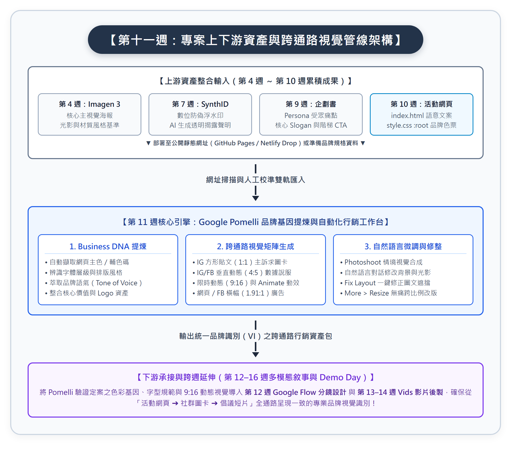
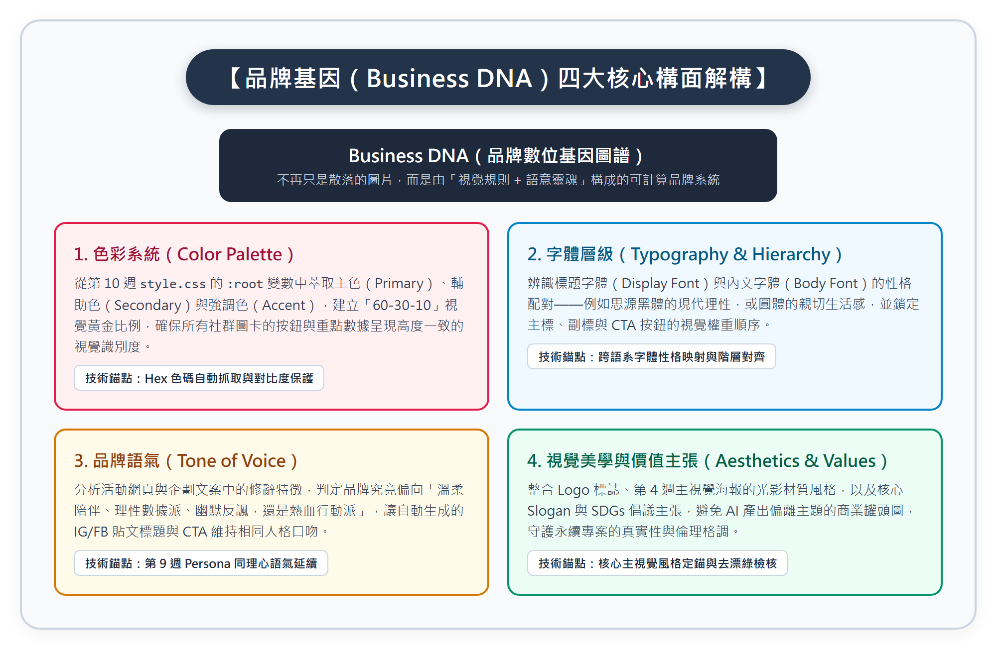
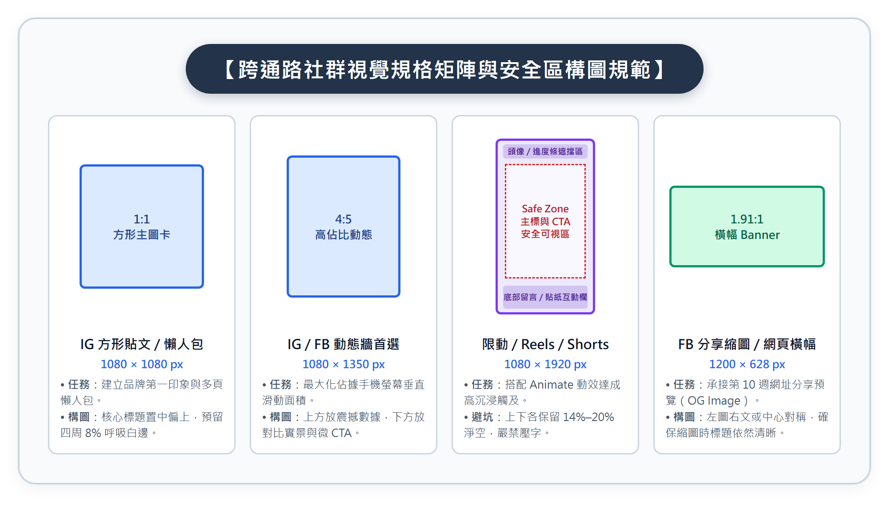
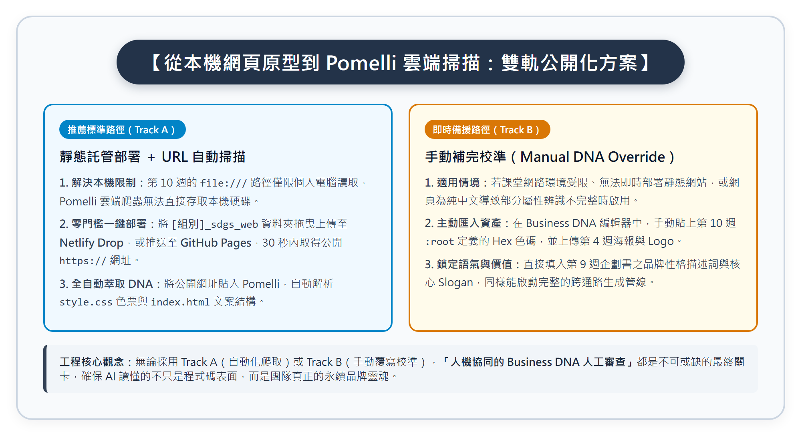
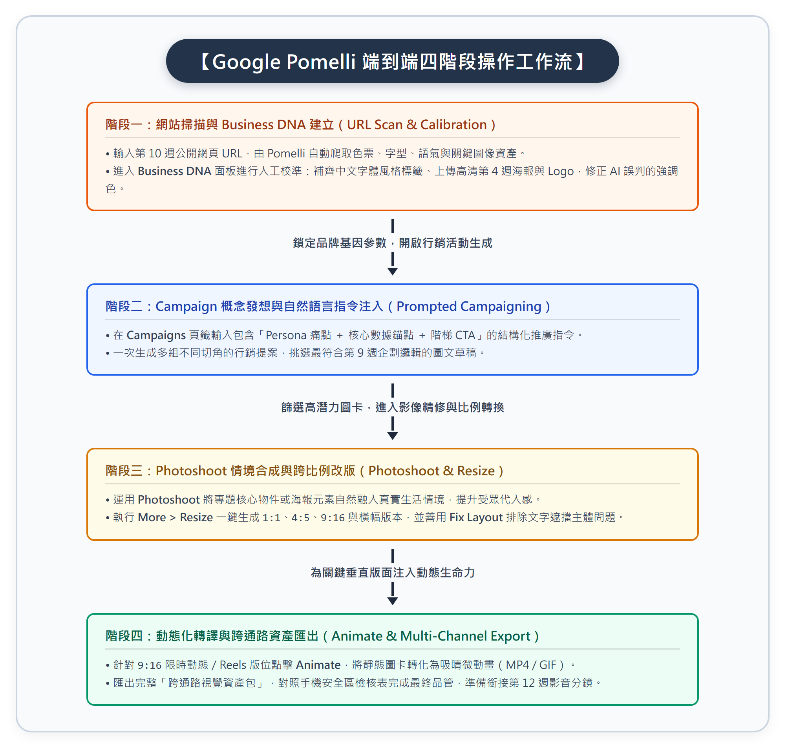
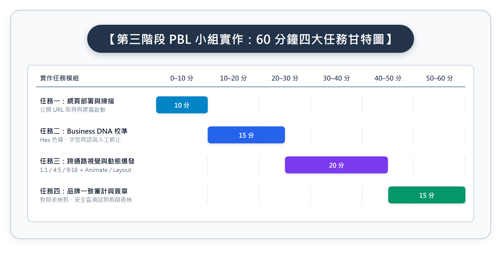

---
puppeteer:
  displayHeaderFooter: true
  headerTemplate: '<div style="font-size: 10px; margin: 0 auto;">第十一週：品牌 DNA 提煉與跨通路視覺自動化（Google Pomelli）</div>'
  footerTemplate: '<div style="font-size: 10px; margin: 0 auto;">第 <span class="pageNumber"></span> 頁 / 共 <span class="totalPages"></span> 頁</div>'
  margin:
    top: "1.5cm"
    bottom: "1.5cm"
    left: "1.5cm"
    right: "1.5cm"
---
<style>
  /* 全域字型、字級與行距 */
  body {
    font-size: 16pt !important;
    line-height: 1.7 !important;
    font-family: "Microsoft JhengHei", "PingFang TC", "Helvetica Neue", sans-serif;
  }

  /* 階層標題微調 */
  h1 { font-size: 28pt !important; margin-bottom: 0.5em !important; }
  h2 { font-size: 22pt !important; page-break-before: always; }
  h3 { font-size: 18pt !important; }
  h4 { font-size: 15pt !important; }

  /* 表格文字與排版優化 (防 PDF 溢出) */
  table {
    width: 100% !important;
    max-width: 100% !important;
    table-layout: fixed !important;
    border-collapse: collapse !important;
    box-sizing: border-box !important;
    margin: 1.2em 0 !important;
    page-break-inside: auto !important;
  }

  thead {
    display: table-header-group !important;
  }

  tr {
    page-break-inside: avoid !important;
  }

  th, td {
    font-size: 11pt !important;
    line-height: 1.45 !important;
    padding: 6px 8px !important;
    border: 1px solid #d0d7de !important;
    vertical-align: top !important;
    word-wrap: break-word !important;
    word-break: break-word !important;
    overflow-wrap: anywhere !important;
    white-space: normal !important;
  }

  th {
    background-color: #f6f8fa !important;
    font-weight: bold !important;
    text-align: left !important;
  }

  /* 智慧欄寬配比 */
  /* 2 欄表格 (例如：實作單) */
  table tr > th:first-child:nth-last-child(2),
  table tr > td:first-child:nth-last-child(2) {
    width: 28% !important;
  }
  table tr > th:nth-child(2):nth-last-child(1),
  table tr > td:nth-child(2):nth-last-child(1) {
    width: 72% !important;
  }

  /* 3 欄表格 */
  table tr > th:first-child:nth-last-child(3),
  table tr > td:first-child:nth-last-child(3) {
    width: 22% !important;
  }
  table tr > th:nth-child(2):nth-last-child(2),
  table tr > td:nth-child(2):nth-last-child(2) {
    width: 28% !important;
  }
  table tr > th:nth-child(3):nth-last-child(1),
  table tr > td:nth-child(3):nth-last-child(1) {
    width: 50% !important;
  }

  /* 4 欄表格 */
  table tr > th:first-child:nth-last-child(4),
  table tr > td:first-child:nth-last-child(4) {
    width: 18% !important;
  }
  table tr > th:nth-child(2):nth-last-child(3),
  table tr > td:nth-child(2):nth-last-child(3) {
    width: 26% !important;
  }
  table tr > th:nth-child(3):nth-last-child(2),
  table tr > td:nth-child(3):nth-last-child(2) {
    width: 28% !important;
  }
  table tr > th:nth-child(4):nth-last-child(1),
  table tr > td:nth-child(4):nth-last-child(1) {
    width: 28% !important;
  }

  /* 程式碼與提示詞區塊 (防 PDF 溢出) */
  pre {
    font-size: 11pt !important;
    line-height: 1.5 !important;
    font-family: Consolas, "Courier New", monospace !important;
    white-space: pre-wrap !important;
    word-wrap: break-word !important;
    word-break: break-word !important;
    overflow-wrap: anywhere !important;
    max-width: 100% !important;
    box-sizing: border-box !important;
    margin: 1em 0 !important;
    padding: 10px 14px !important;
    background-color: #f6f8fa !important;
    border: 1px solid #d0d7de !important;
    border-radius: 6px !important;
    page-break-inside: avoid !important;
  }

  pre code {
    font-size: 11pt !important;
    line-height: 1.5 !important;
    font-family: Consolas, "Courier New", monospace !important;
    white-space: pre-wrap !important;
    word-wrap: break-word !important;
    overflow-wrap: anywhere !important;
  }

  code:not(pre code) {
    font-size: 0.9em !important;
    font-family: Consolas, "Courier New", monospace !important;
    background-color: rgba(175, 184, 193, 0.2) !important;
    padding: 0.2em 0.4em !important;
    border-radius: 3px !important;
  }
</style>

# 第十一週：品牌 DNA 提煉與跨通路視覺自動化——從系統化視覺識別、Google Pomelli 到跨社群格式爆發

## 課程導讀

在上一週（第 10 週）的課堂中，我們運用 **Gemini Canvas** 與「關注點分離（Separation of Concerns，SoC）」的工程原則，成功將第九週的《SDGs 專題企劃書》轉化為可在瀏覽器真實運行的活動單頁原型（One-Page Landing Page）。各組不僅確立了七大黃金模組的說服動線，更在 `style.css` 頂部的 `:root` 區塊中，有意識地將專案的主色、輔助色與強調色收斂為標準化的色票變數。

然而，在真實的數位傳播戰場上，一座製作精良的活動網頁只是「大本營」，卻無法自己走到受眾的眼前。現代大學生與社群大眾每日接觸資訊的入口，分散在 Instagram 動態牆、限時動態（Stories）、Reels 短影音、Facebook 貼文與各式行動端橫幅之中。如果活動網頁上線後，小組沒有一套高效率的機制將網頁裡的視覺美學與核心主張延伸至各大社群平台，流量就無從導入，再優秀的網頁原型也只能靜靜等待少數主動造訪的訪客。

本週（第 11 週），我們正式邁入專案進程的第三大階段—— **【品牌 DNA 提煉與跨通路視覺自動化】** 。我們將運用 Google Labs 與 Google DeepMind 合作推出的品牌行銷自動化工具 **Google Pomelli**，示範如何讓人工智慧直接掃描各小組在第 10 週建立的活動網頁，將零散的色彩代碼、排版語氣與主視覺海報，凝鍊成可重複調用的 **品牌數位基因（Business DNA）** ，並在數分鐘內一鍵衍生出符合各社群通路規格的整合行銷素材包。

為了幫助同學看清本週在整個 16 週課程管線中的關鍵樞紐位置，圖 11-1 描繪了第十一週如何承接第 4 週至第 10 週的前期成果，並為第 12 週以後的多模態影音敘事提供統一的品牌視覺標準。



從圖 11-1 可以觀察到，第十一週扮演著「靜態資產系統化」與「多通路規模擴張」的橋樑角色。上游第 4 週的主視覺海報、第 7 週的 SynthID 透明揭露聲明、第 9 週的 Persona 受眾痛點與第 10 週的 `:root` 網頁色票，都在本週匯聚至 Google Pomelli 工作台，經過提煉、情境合成與多尺寸轉換後，輸出成一致的跨平台品牌識別資產。

> **「在生成式 AI 時代，產出一張漂亮的圖並不稀奇；真正考驗數位內容設計師功力的，是讓十個不同通路、十種不同尺寸的素材，在受眾眼裡依然像同一個靈魂說出來的同一件事。」**

本週課堂同樣維持緊湊且高效的 110 分鐘標準三段式結構：
- **第一階段（25 分鐘）：** 核心理論講授——建立「系統化視覺識別」思維，解析 Business DNA 四大構面、60-30-10 色彩配比原則，以及跨通路社群尺寸與手機安全區規範。
- **第二階段（25 分鐘）：** AI 工具操作示範——演練從本機網頁公開化部署到 Google Pomelli 掃描的雙軌路徑，並實機示範 Campaigns 提示詞注入、Photoshoot 情境合成、Fix Layout 修復與 Animate 動態化功能。
- **第三階段（60 分鐘）：** PBL 小組實作——各組完成網頁公開與基因校準，產出涵蓋 `1:1`、`4:5`、`9:16` 與 `1.91:1` 的跨通路素材包，並接受「同儕 3 秒滑動盲測」與教師查核簽章。

---

## 第一節：品牌識別系統化與 Business DNA 理論解析

### 1.1 為什麼活動網頁上線後，仍需要「跨通路視覺自動化」？

許多初次籌備大型倡議活動的團隊，在網頁與主視覺海報完成後，往往會低估後續社群宣傳的製作成本。當團隊需要發布倒數預告貼文、數據懶人包、限時動態互動投票與臉書活動橫幅時，傳統的作業模式通常會陷入兩種困境：第一種是「硬套單一海報」，直接把第 4 週直式海報截圖或加上粗暴的白邊丟進 Instagram 或 Facebook，導致在手機螢幕上字體小到無法閱讀，重要數據甚至被裁切；第二種則是「全員各自發揮」，由四位組員分別開啟不同的修圖軟體製作各平台圖卡，結果 A 同學用了鮮豔的螢光綠，B 同學用了沉重的深海藍，C 同學甚至換成了可愛手寫字體。

當受眾在不同社群平台滑過同一場活動的貼文，卻感受到截然不同的色調與口吻時，品牌的 **視覺識別一致性（Visual Identity Consistency）** 就會瞬間瓦解，進而大幅削弱倡議的專業度與可信度。在現代數位行銷實務中，為了解決「多尺寸改版耗時」與「多人協作風格走鐘」這兩大痛點，設計流程正從過去的手動逐張美編，轉向以系統參數為核心的自動化生產管線。下表從五個關鍵管理維度，比較了傳統手動改版模式與品牌基因自動化模式之間的本質差異。

| 比較維度 | 傳統手動美編改版模式（Manual Resizing） | 品牌基因自動化管線（Business DNA Pipeline） |
| :--- | :--- | :--- |
| **設計起點** | 每次開新檔案都要重新挑選色盤與排版模板 | 先建立唯一真實來源（Single Source of Truth）的品牌基因檔 |
| **多尺寸適配** | 設計師必須針對 `1:1`、`4:5`、`9:16` 逐一拖拉圖層重排 | 系統依據版面權重自動重組構圖，並保留核心圖文關係 |
| **文案與語氣** | 依撰稿人當下心情書寫，各平台口吻容易前後矛盾 | AI 鎖定預先分析的 Tone of Voice，維持一致的人格口吻 |
| **迭代與修改成本** | 若活動標語或主色調整，需人工逐檔翻找並重新匯出 | 更新核心 DNA 參數或自然語言指令，即可批次重新衍生 |
| **創作者核心精力** | 約 70% 時間耗在對齊圖層、改尺寸與修字距等重複勞動 | 專注於受眾洞察、情境創意切角與最終品質審核 |

透過上表的對照可以清楚發現，跨通路視覺自動化的真正價值，並不是「讓 AI 隨意畫圖」，而是將繁瑣重複的尺寸重排與風格對齊交由系統運算，讓大學生創作者得以把時間保留給策略思考與受眾同理。要實現這套自動化管線，前提是我們必須先將抽象的「品牌感覺」，拆解成機器與團隊都能精準讀寫的結構化規格。

---

### 1.2 什麼是 Business DNA（品牌數位基因）？四大核心構面解構

在傳統企業品牌管理中，大型企業會聘請設計顧問撰寫厚達數百頁的《企業識別系統手冊（Corporate Identity System，CIS）》或《品牌風格指南（Brand Guidelines）》，詳細規定標誌最小間距、標準色碼與印刷規範。然而，對節奏極快的數位專案與學生團隊而言，製作一份靜態 PDF 手冊不僅耗時，而且無法直接被生成式 AI 引擎讀取與執行。

為了解決這項落差，Google Pomelli 提出了 **品牌數位基因（Business DNA）** 的核心概念。所謂 Business DNA，是指將一個品牌外顯的「視覺規則」與內隱的「語意靈魂」，透過網頁爬蟲與多模態分析，萃取為一組可被 AI 模型即時檢索、約束生成邊界的結構化設定檔。圖 11-2 完整呈現了 Business DNA 的四大核心構面，以及它們如何與本課程前十週累積的專案資產產生精準映射。



觀察圖 11-2 中的四個維度，同學們可以理解為什麼我們在第 10 週強烈要求必須建立獨立的 `style.css` 檔案與語意化的 `index.html`：

1. **色彩系統（Color Palette）：** 當 Pomelli 掃描你的活動網頁時，它會解析 CSS 中高頻出現的背景色、文字色與按鈕強調色，對應我們在第 10 週 `:root` 中定義的 `--color-primary`、 `--color-secondary` 與 `--color-accent`。在商業視覺設計中，這組色票通常遵循經典的 **「60-30-10 配色黃金法則」** ——亦即 60% 的版面面積留給中性或溫和的主背景色以維持呼吸感，30% 分配給代表議題特質的輔助色塊以建立區塊層次，最後僅將最搶眼的 10% 留給 **強調色（Accent Color）** ，專門用於行動呼籲（Call-to-Action，CTA）按鈕與關鍵數據數字。如果一張社群圖卡到處都是高飽和度的亮色，受眾的眼睛就會失去焦點。
2. **字體層級（Typography & Hierarchy）：** 系統會偵測網頁上標題（`<h1>`、`<h2>`）與內文（`<p>`）的字型家族、粗細對比與大小比例。字體本身就是無聲的品牌語言：幾何無襯線體（如思源黑體、Inter）能傳遞理性、數據實證與現代行動力；襯線體或圓體則偏向人文敘事、社區記憶或溫暖陪伴。鎖定字體層級，能確保所有跨平台圖卡的主標題、副標與按鈕文字永遠保持清晰的閱讀順序。
3. **品牌語氣（Tone of Voice）：** 這是許多純圖像設計軟體容易忽略的維度。AI 會閱讀活動網頁上的 Slogan、痛點描述與按鈕動詞，歸納出品牌與受眾對話的性格特徵——究竟是像朋友般親切幽默，還是像研究員般冷靜客觀？這項基因將直接決定 Pomelli 後續生成社群廣告標題與貼文副標時的用字遣詞，讓文字風格緊密貼合第 9 週確立的 Persona 同理心策略。
4. **視覺美學與價值主張（Aesthetics & Values）：** 除了顏色與文字，品牌基因還涵蓋了標誌（Logo）檔案、第 4 週 Imagen 3 主視覺海報的光影材質調性，以及團隊最核心的 SDGs 永續價值主張。將真實海報與倡議核心寫入基因庫，能防止 AI 在自動生成廣告時，擅自套用毫無關聯的商業促銷罐頭圖片，從根源杜絕內容漂綠（Greenwashing）與風格斷裂。

---

### 1.3 跨通路社群視覺規格矩陣與手機安全區（Safe Zone）設計原則

擁有一組精準的 Business DNA 之後，下一個關鍵問題是：相同的品牌靈魂，應該如何適配不同社群平台的物理畫布？許多初學者常誤以為「跨通路排版」就是把同一張設計稿等比例放大或縮小。事實上，每一個社群平台都有截然不同的使用者瀏覽姿勢、演算法版位權重與介面遮擋區域。

圖 11-4 展示了數位行銷實務中最核心的四種跨通路視覺規格比例，並特別標註了行動裝置瀏覽時極易踩雷的「安全區（Safe Zone）」構圖邊界。



對照圖 11-4 的比例框架與真實操作情境，我們可以進一步將四種主力規格的行銷任務、資訊密度與版面禁忌整理為下表，作為各小組在本週產出素材包時的設計準則。

| 版位規格與比例 | 標準像素尺寸 | 主要應用通路與行銷任務 | 構圖重點與排版禁忌 |
| :--- | :--- | :--- | :--- |
| **方形貼文（1:1）** | `1080 × 1080 px` | Instagram 個人檔案格狀牆面、多頁左右滑動懶人包（Carousel） | 主標題建議置中或居於中上視覺重心，四周保留至少 8% 呼吸邊距，避免文字緊貼邊緣造成壓迫感。 |
| **垂直動態圖（4:5）** | `1080 × 1350 px` | Instagram 與 Facebook 行動端動態牆（Feed）主力版位 | 在手機螢幕上擁有最高的垂直佔比與停留優勢；適合上方放置第 5 週震撼數據，下方搭配情境圖與微 CTA。 |
| **全螢幕直式（9:16）** | `1080 × 1920 px` | Instagram Stories、Reels 與 YouTube Shorts 動態短影音 | **必須嚴守安全區規範**：頂部約 14% 會被帳號頭像與進度條遮擋，底部約 20% 會被留言欄與互動貼紙覆蓋，關鍵標題與按鈕必須集中於中央安全區。 |
| **橫式橫幅（1.91:1）** | `1200 × 628 px` | Facebook 連結分享預覽圖（Open Graph Image）、活動網頁頂部 Banner | 高度較窄，不適合塞入長段文字；宜採用「左圖右文」或「單一句 Slogan 搭配高反差底圖」，確保在手機縮圖預覽時依然可讀。 |

從上表可以理解，在 `9:16` 全螢幕直式版位中，介面遮擋是最常見的實務失誤。許多組員在電腦大螢幕上製作限時動態圖卡時，習慣把最重要的行動呼籲按鈕放在畫面最底部，或把活動 Logo 貼在最左上角，結果一上傳到手機實測，Logo 剛好被自己的 Instagram 頭像擋住，CTA 按鈕則被「傳送訊息」輸入框完全掩埋。掌握「安全區（Safe Zone）」意識，正是區分業餘美編與專業數位內容設計師的重要分水嶺。

---

### 1.4 課堂探索小活動：3 分鐘「品牌基因診斷與色票 60-30-10 快速盤點」

現在請各小組打開第 10 週完成的 `style.css` 與第 4 週主視覺海報，進行 3 分鐘的快速診斷（3 分鐘）：
1. **盤點三個核心 Hex 色碼：** 找出 `style.css` 頂部 `:root` 裡的 `--color-primary`、 `--color-secondary` 與 `--color-accent` 三組色碼（例如 `#1B4332`、`#D8F3DC`、`#F59E0B`）。
2. **檢驗 60-30-10 角色分工：** 小組快速確認這三個顏色中，哪一個是佔據 60% 版面的穩重背景色？哪一個是最搶眼、只保留 10% 面積用來引導點擊的強調色（Accent）？如果三個顏色飽和度都過高、彼此互搶視覺焦點，請立即挑選其中一個調整為低飽和中性色。
3. **提煉三個語氣關鍵詞：** 朗讀第 10 週網頁首頁的主標題與 CTA 按鈕文案，組員共同寫下 3 個最能代表你們專案人格的形容詞（例如：「直白、微幽默、具行動感」或「溫柔、實證導向、不說教」），準備作為稍後校準 Business DNA 的依據。

---

### 1.5 老師的提醒

> **老師的提醒：**
> * **千萬別把 Pomelli 當成「只按一次的抽獎機」！** 許多同學看到 AI 能掃描網址直接吐出十幾張社群圖片，就感到非常興奮，不加檢查便直接下載交差。請記住，自動化工具追求的是「高起點的規模產能」，而不是「零思考的盲目交付」。如果 Business DNA 的主色抓錯了網頁的頁尾灰底，或者把中文字體的性格判定錯誤，後續產出的十張圖就會一起偏離軌道。 **花 5 分鐘精準校準基因，遠勝過花 50 分鐘修補錯誤的生成圖！**
> * **留意強調色與文字之間的對比度（Contrast Ratio）：** 在製作社群圖卡時，最常見的失誤是把淺黃色或亮綠色的強調色文字，直接壓在複雜的照片背景上，導致手機閱讀極為吃力。請務必檢查文字與底圖之間是否具備足夠的明暗反差（建議符合無障礙網頁標準 WCAG AA 級的 4.5:1 對比度），必要時為背景加上半透明深色漸層遮罩（Overlay），讓核心倡議訊息清晰跳脫出來。

---

## 第二節：Google Pomelli 實戰工作流——從網址掃描、Photoshoot 到動態跨通路爆發

### 2.1 從本機原型到雲端掃描：雙軌公開化路徑（Track A 與 Track B）

理解了 Business DNA 的理論基礎後，我們現在要進入工具實操示範（25 分鐘）。在正式開啟 **Google Pomelli**（網址為 `labs.google.com/pomelli`）之前，我們必須先解決一個極為關鍵的技術門檻：第 10 週各小組所建立的活動網頁，目前是儲存在個人筆電硬碟中的 `file:///C:/...` 本機檔案。當我們在 Pomelli 輸入網址時，Google 雲端伺服器上的爬蟲程式無法穿透防火牆讀取你筆電硬碟裡的私有資料夾。

為了讓所有小組在課堂上都能順利啟動品牌提煉流程，我們規劃了「雙軌公開化方案」，圖 11-5 說明了標準部署路徑（Track A）與即時備援路徑（Track B）的適用情境與操作步驟。



如圖 11-5 所示， **Track A（靜態託管部署 ＋ URL 自動掃描）** 是本課程強烈推薦的標準路徑。過去將網站放上網際網路需要租用主機與設定伺服器，門檻極高；但在現代靜態網站託管服務下，非資訊科系的大二同學只需兩個簡單步驟即可完成：
- **極速方案（Netlify Drop）：** 開啟免費的靜態託管拖曳頁面，直接把第 10 週整理好的 `[組別]_sdgs_web` 整個資料夾（內含 `index.html`、`style.css`、`script.js` 與 `img/`）拖曳進瀏覽器視窗，系統會在 30 秒內自動配發一組公開的 `https://...` 網址。
- **工程協作方案（GitHub Pages）：** 若小組已經習慣使用 GitHub 管理專題原始碼，將檔案推送至 Repository 後，在 Settings 頁面開啟 GitHub Pages，同樣能立即獲得可公開存取的永久網址。

一旦取得公開的 `https://` 網址，不僅 Pomelli 的引擎能完整讀取你在 `style.css` 中設定的色票變數與字體階層，第 16 週 Demo Day 發表時，現場評審與觀眾也能直接用手機掃描 QR Code 體驗你們的活動網頁。而若遇到課堂臨時網路環境受限，或團隊希望先測試部分視覺素材時，則可立即切換至 **Track B（手動補完校準）** ——在 Pomelli 介面中跳過或略過自動爬蟲限制，直接手動輸入 Hex 色碼、上傳第 4 週海報與 Logo 並填入品牌主張，同樣能驅動後續所有生成功能。

---

### 2.2 Google Pomelli 端到端四階段操作心法

當我們登入 Google Pomelli 並準備好網址或品牌資產後，完整的跨通路視覺生產將沿著一條清晰且可反覆迭代的四階段工作流展開。圖 11-3 彙整了從「基因建立」到「動態匯出」的端到端操作路徑，以下我們將逐一拆解每個階段的實戰操作細節與控制技巧。



1. **階段一：網站掃描與 Business DNA 人工校準（URL Scan & Calibration）**
   將公開網址貼入 Pomelli 首頁的輸入框並執行掃描後，系統會在數十秒內自動整理出一份 **Business DNA Profile** 摘要頁。請同學千萬不要急著按下一步，而是逐欄展開以下四項校準檢查：
   - **Color Palette（色彩系統）：** 檢查 AI 擷取的主色與強調色是否與第 10 週 `:root` 完全一致。有時網頁上某張照片的底色或頁尾灰色會被誤認為品牌主色，此時請點擊色塊手動貼回正確的 Hex 色碼。
   - **Typography（字體設定）：** 由於實驗室工具目前對繁體中文字體的自動辨識有時會回退為預設字型，請手動選擇視覺性格最接近的字體類別（例如現代黑體或人文襯線體），確保標題與內文的粗細反差明確。
   - **Assets & Logo（資產庫與標誌）：** 確認第 4 週的核心主視覺海報與小組專題 Logo 已經完整收錄於資產庫中，且畫質清晰、無裁切缺角。
   - **Tone of Voice & Values（語氣與核心主張）：** 檢視系統自動摘要的品牌語氣標籤與核心口號，若 AI 摘要過於商業化或偏離倡議初衷，請立即以中文或簡潔英文補齊專案的 Slogan 與核心痛點描述。

2. **階段二：Campaign 概念發想與自然語言指令注入（Prompted Campaigning）**
   完成 Business DNA 鎖定後，點擊左側選單進入 **Campaigns** 功能區。Pomelli 會依據你的品牌基因自動推薦數個行銷切角，但為了讓產出精準對接第 9 週《企劃書》，我們更建議在對話框中主動下達 **結構化活動指令（Campaign Prompt）** 。例如設定「推廣對象為外宿大學生」、「主軸為第 5 週震撼數據對比」以及「導向第 10 週網頁承諾表單」。系統隨即會同時生成數組視覺構圖與文案結構各異的廣告提案，供團隊比選最佳方向。

3. **階段三：Photoshoot 情境合成與跨比例改版（Photoshoot & Resize）**
   在傳統製作流程中，如果缺乏經費拍攝實體倡議照片，社群圖卡往往會顯得像冰冷的純文字簡報。此時可以運用 Pomelli 內建的 **Photoshoot** 工具：只要上傳一張與你專題相關的核心物件照片或海報主角（例如重複使用玻璃吸管、醜蔬果食材籃、舊衣改造提袋），選擇生活化或攝影棚風格模板，AI 便能結合你的 Business DNA 色彩燈光，將主體自然合成進真實的桌面或日常場景中，大幅提升受眾的代入感。

   選定主力視覺草稿後，接著進入跨平台尺寸轉換：點選圖卡右上角的 **More > Resize** ，即可將一張定稿的 `1:1` 貼文，無痛轉換為 `4:5` 動態牆圖卡、`9:16` 限時動態與 `1.91:1` 橫幅。如果在轉換尺寸或輸入較長中文標題後，發現文字與圖片人物重疊，請直接點擊內建的 **Fix Layout** 按鈕，或在自然語言修改框輸入「將背景色調調暖、人物往右移以騰出左側文字空間」，系統便會自動重新演算圖層安全距離。

4. **階段四：動態化轉譯與跨通路資產匯出（Animate & Export）**
   在演算法高度偏好短影音與動態吸睛元素的社群環境中，靜態圖片往往較難在限時動態與 Reels 奪得停留時間。針對產出的 `9:16` 垂直版面，同學們可以直接點擊工具列上的 **Animate** 功能。Pomelli 會將靜態圖層中的背景光影、主標文字或主題物件轉化為流暢的微動態效果。完成預覽並確認無誤後，點選 **More > Download** ，即可依版位需求匯出高解析度 PNG 靜態圖卡，以及適合上傳限時動態或整合進第 13–14 週影片專案的 **MP4 或 GIF** 動態檔案。

---

### 2.3 結構化 Campaign 提示詞設計與「品牌一致性審計」

為了避免在 Pomelli 的 Campaigns 對話框中打出「幫我做一張好看的環保 IG 圖」這類模糊指令，導致 AI 產出空洞的地球與綠葉罐頭圖，我們延續第 3 週所學的結構化提示工程原則，將跨通路行銷指令拆解為四個核心欄位： **「目標版位與比例 ＋ 第九週受眾與痛點 ＋ 第五週數據或解方 ＋ 第十週階梯 CTA」**。

在實際下達指令時，建議各組參考以下提示詞結構模板，並依據本組 SDGs 主題替換括號內的真實專案資訊。這段提示詞的目的在於強制 AI 將「心理說服邏輯」與「Business DNA 視覺規範」綁定在一起，避免視覺與文案各自為政。

```text
【任務目標】：為我們的 SDGs 倡議活動生成一組跨通路社群宣傳圖卡（優先產出 4:5 動態牆與 9:16 限時動態規格）。
【目標受眾與痛點】：鎖定每天外食、想兼顧省錢與健康的 18-24 歲大學外宿生，破除「永續行動都很貴又麻煩」的心理抗拒。
【核心文案與數據注入】：
- 主標題（限 12 字內）：外表不完美，深夜料理照樣滿分！
- 副標題（注入數據）：台灣每年浪費逾 30% 格外品蔬果，其實營養完全相同。
- 行動呼籲（CTA 按鈕）：立即領取 300 元週食譜（對應活動網頁承諾表單）
【視覺風格與構圖要求】：嚴格遵循本專案 Business DNA 色票與溫暖生活感語氣。主視覺採用暖色調木質餐桌攝影感，文字區保留足夠留白與高對比度遮罩，並於 9:16 版位嚴守上下安全區規範，切勿遮擋核心標題。

```

在上述提示詞結構中，有三個細節最值得同學注意。第一，明確限制主標題字數（如 12 字以內），能避免生成圖卡因文字過多而造成排版擠壓與中文斷行錯亂；第二，直接寫入第 5 週萃取的數據與第 9 週的具體低門檻 CTA，讓社群圖卡與活動網頁形成前後呼應的說服漏斗；第三，主動宣告安全區與高對比度要求，能大幅減少後續使用 Fix Layout 的修正次數。

當所有素材生成並匯出後，設計師還必須以「品牌總監」的視角執行最終的 **品牌一致性審計（Brand Consistency Audit）** ，確認產出的圖卡在跨平台之間是否真正達成「同一個品牌靈魂」。此外，別忘了回扣第 7 週所學的科技倫理底線：若圖卡中包含 AI 生成或 Photoshoot 合成之擬真生活影像，應在社群貼文文案或圖卡角落保持透明揭露，並確保數據引用皆來自第 5 週查核過之真實文獻，絕不為了吸睛而誇大數字或製造假新聞。

---

### 2.4 課堂探索小活動：3 分鐘「自然語言精修與 Fix Layout 救援演練」

在教師示範階段結束前，請各小組立即使用示範網址或測試品牌，在筆電上進行 3 分鐘極速微調演練：
1. 在 Pomelli 生成的任一張初版圖卡中，刻意挑選一張「文字稍微壓到圖片主體」或「背景色彩過於冰冷」的卡片。
2. 點選上方的 **Fix Layout** 功能，觀察 AI 如何自動調整文字框位置與邊距留白。
3. 接著在自然語言修改欄輸入一段具體指令，例如：「將背景改為溫暖柔和的自然日光桌面質感，並提升主標題文字底部的半透明深色對比，讓手機閱讀更清晰。」
4. 比對前後兩張圖的視覺焦點變化，感受自然語言精修如何取代繁瑣的圖層調整作業。

---

### 2.5 老師的提醒

> **老師的提醒：**
> * **文字過載是社群圖卡的「頭號殺手」：** 很多同學總想把第 9 週企劃書裡的三百字痛點故事，全部塞進一張 `1080 × 1080` 的 IG 圖卡裡。請記住， **社群圖卡的任務是「在 3 秒內引發好奇並點擊導流」，而不是「在圖卡上寫完論文」** ！把長文字留給 IG 貼文內文區與第 10 週的活動網頁，圖卡上只保留「一個視覺焦點 ＋ 一句 12 字內金句 ＋ 一個明確 CTA」。
> * **跨語言排版的實務微調心法：** 目前 Google Pomelli 等國際級 AI 行銷引擎的底層排版美學主要是針對英文單字與拉丁字體比例訓練的，當輸入繁體中文時，偶爾會出現行距過緊、英文與中文混排大小不均，或系統誤判成簡體字型風格的情況。實作時務必開啟人工檢視模式：必要時可在 Pomelli 先鎖定「無文字或極簡主標底圖 ＋ 品牌色塊結構」，或搭配手調字距與分段換行，確保繁體中文呈現出雜誌級的精緻閱讀質感。

---

## 第三節：PBL 課堂工作坊——跨通路品牌資產包建置與同儕品牌審計

### 3.1 課堂實作總覽與 60 分鐘進度規劃

現在，我們正式進入本週的核心實戰—— **PBL 小組課堂實作工作坊（60 分鐘）** 。在本節課結束時，每一個小組都必須交付一套完整、可立即發布於社群平台，且與第 10 週活動網頁視覺高度一致的「跨通路品牌視覺資產包」。

為了確保各小組能精準掌握時間節奏，避免在單一圖片生成畫面卡關過久而壓縮最終品管時間，圖 11-6 規劃了 60 分鐘四大任務的標準進度甘特圖，請各組專案經理（PM）依循時程推進任務。



從圖 11-6 的時程配置可以看到，前 25 分鐘（任務一與任務二）是打好品牌基因地基的關鍵期，緊接著中間 20 分鐘（任務三）全面爆發產出多尺寸圖卡與動態素材，最後預留完整的 15 分鐘（任務四）執行同儕盲測與教師簽章審核。請各組由視覺總監（Visual & Brand Lead）主導操作介面，內容策略師負責提示詞文案精煉，PM 掌控時間與實作工作單填寫。

---

### 3.2 任務一：靜態網頁公開部署與 Pomelli 引擎掃描（10 分鐘）

請各小組立即檢查第 10 週完成的 `[組別]_sdgs_web` 專案資料夾，確認內部已包含 `index.html`、`style.css`、`script.js` 與 `img/` 圖像資源，並依以下步驟完成掃描啟動：
1. **執行公開化路徑（Track A）：** 將資料夾拖曳部署至 Netlify Drop 或推送啟用 GitHub Pages，取得可於公網瀏覽的 `https://` 網址。立即用手機掃描或點擊該網址，確認第 4 週主視覺海報與 CSS 樣式能正常顯示於線上環境。
2. **啟動 Pomelli 品牌提煉：** 開啟 `labs.google.com/pomelli` 並登入 Google 帳號，將公開網址貼入掃描列，等待系統完成網頁爬蟲與初始檔案建置。
3. **備援機制（Track B）：** 若個別小組因資料夾路徑錯誤導致線上圖片暫時破圖，或遭遇即時網路延遲，請於 5 分鐘內果斷切換至 Track B，直接開啟手動設定面板展開任務二。

---

### 3.3 任務二：Business DNA 四維校準與資產庫建置（15 分鐘）

掃描完成後，全組圍繞螢幕共同審查系統生成的 Business DNA 設定檔，並對照第 10 週 `style.css` 完成以下校準動作：
1. **色彩變數對齊檢查：** 逐一比對 Pomelli 擷取到的 Primary、Secondary 與 Accent 三組 Hex 色碼，若與 `:root` 宣告存在誤差，立即手動覆寫修正，並確認強調色保留給最重要的 CTA 元件。
2. **字體與資產庫補全：** 手動上傳第 4 週高清主視覺海報與小組專題標誌（Logo），確認圖片裁切邊界完整；調整字體層級設定，讓標題呈現出符合議題調性的視覺份量。
3. **語氣與核心主張定義：** 以精準的一句話補充或修正品牌價值主張，將第 9 週確立的受眾對話語氣（如同理陪伴、實證揭露、微行動賦權）寫入品牌設定，並截圖保存「校準後之 Business DNA 總覽畫面」作為專題歷程紀錄。

---

### 3.4 任務三：跨通路視覺矩陣生成、Photoshoot 與 Animate 動態化（20 分鐘）

基因鎖定完成後，各組立即進入規模化資產生成階段。本週規定每組至少必須產出並精修 **四款不同通路規格** 的正式素材，完整覆蓋主流社群接觸點：
1. **素材 A — IG 方形主訴求圖卡（`1:1` / `1080×1080`）：** 運用第二節的結構化 Campaign 提示詞，產出傳遞核心 Slogan 與第 5 週震撼數據的貼文首圖，展現乾淨的 60-30-10 配色層次。
2. **素材 B — IG / FB 垂直情境說服圖（`4:5` / `1080×1350`）：** 選用 Photoshoot 功能，上傳與專題相關的生活物品或核心視覺元素，讓 AI 結合品牌光影將其合成至日常使用情境中，搭配 Persona 痛點副標。
3. **素材 C — 限時動態 / Reels 動態素材（`9:16` / `1080×1920`）：** 透過 `More > Resize` 轉換並結合 `Fix Layout` 調整構圖，將主標題與 CTA 嚴格鎖定在中央安全區；隨後點擊 **Animate** 為靜態版面注入微動態，匯出為 **MP4 或 GIF** 檔案。
4. **素材 D — FB 連結分享 / 網頁宣傳橫幅（`1.91:1` / `1200×628`）：** 產出一張左圖右文或簡潔對稱的橫式 Banner，作為未來在社群分享第 10 週活動網頁連結時的視覺封面。

所有匯出的圖片與動態檔，請統一歸檔於小組專案目錄下的 `assets_pomelli/` 資料夾中，並依照 `ig_post_1x1.png`、`feed_photoshoot_4x5.png`、`story_animate_9x16.mp4`、`fb_banner_191x1.png` 等語意化方式命名。

---

### 3.5 任務四：同儕「3 秒滑動盲測」與教師查核簽章（15 分鐘）

在工作坊最後 15 分鐘，我們將模擬真實社群使用者的瀏覽行為，展開高強度的 **「同儕 3 秒滑動盲測（3-Second Scroll Test）」** 與教師品質稽核：
1. **跨組盲測交換（8 分鐘）：**
   - 相鄰兩組交換檢視螢幕上的第 10 週活動網頁，以及剛剛產出的四款跨通路素材。
   - 測試組同學模擬滑手機的真實速度，每張圖僅觀看 3 秒鐘，隨後誠實回答三個檢驗問題：
     - *品牌連貫性*：如果把這四張圖和你們的活動網頁混在別人的社群動態裡，我能一眼看出它們屬於同一個品牌嗎？
     - *資訊清晰度*：在 `9:16` 限時動態版面中，核心標題與行動呼籲按鈕有沒有避開上下介面遮擋區？文字與背景的對比度是否容易閱讀？
     - *點擊慾望*：看完這些圖卡後，我有沒有動力點擊連結跳轉回你們第 10 週的活動網頁？
2. **教師現場查核簽章（7 分鐘）：**
   - 授課教師與助教逐桌巡視，現場查核實作單上的核心驗收指標：
     - [x] 是否成功建立並校準與 `:root` 色票一致的 Business DNA？
     - [x] 是否產出完整四種比例規格（`1:1`、`4:5`、`9:16`、`1.91:1`）？
     - [x] 是否實際應用了 Photoshoot 情境合成、Fix Layout 修復或自然語言調校？
     - [x] `9:16` 動態化輸出（MP4/GIF）是否嚴格符合手機安全區規範，無壓字遮擋？
   - 通過所有指標之小組，由教師於《實作單》審查欄正式簽章核可！

---

### 3.6 老師的真心話

> **老師的真心話：**
> * **跨出「單點作圖」的思維舒適圈！** 同學們，今天你們經歷了一場從「手工業」邁向「品牌系統工程」的關鍵思維升級。以前做報告或辦活動，大家習慣前一天晚上才臨時做一張海報、隔天再做一張完全不同風格的 IG 圖，結果整場活動看起來支離破碎。今天透過第 10 週寫好的 CSS 變數，加上第 11 週的 Business DNA，你們第一次體會到什麼叫做「用同一套品牌靈魂，高效率地驅動所有社群通路」。
> * **AI 時代的審美把關者永遠是你自己！** 雖然 Pomelli 能在一分鐘內幫你生成十幾種版型與動效，但千萬別忘記今天同儕盲測給你的震撼——很多時候 AI 覺得好看的配色，在手機強光下其實難以辨識；AI 覺得豐富的構圖，放進限動卻剛好被留言框擋住。這正是人類設計師無可取代的價值： **技術負責加速擴張，而你負責守住品牌格調與真實的受眾體驗**。

---

## 本章小結與課後任務

### 核心觀念回顧

1. **系統化視覺識別的價值：** 在多平台分散傳播的數位環境下，單靠活動網頁或單張海報無法觸及受眾；唯有建立統一的視覺識別系統，才能消除多人協作下的風格斷裂，累積品牌信任感。
2. **Business DNA 四大核心構面：** 品牌數位基因由色彩系統（Color Palette，遵循 60-30-10 配比法則）、字體層級（Typography）、品牌語氣（Tone of Voice）與視覺美學主張（Aesthetics & Values）共同構成，並與第 10 週 `style.css` 的 `:root` 變數緊密相連。
3. **雙軌公開化與人機協同校準：** 透過靜態網站託管（Netlify Drop / GitHub Pages）取得公開 `https://` 網址，讓雲端 AI 引擎自動掃描提取基因，或於需要時啟動人工覆寫校準，同時落實人工審查以修正中文語境與色碼誤差。
4. **Google Pomelli 全鏈自動化功能：** 掌握 Campaigns 結構化提示生成、Photoshoot 情境攝影合成、More > Resize 跨尺寸改版、Fix Layout 版面修復，以及 Animate 一鍵靜態轉動態（MP4/GIF）的完整操作閉環。
5. **跨通路規格與安全區防線：** 徹底區分 `1:1`、`4:5`、`9:16` 與 `1.91:1` 在手機瀏覽行為上的差異，嚴格執行 `9:16` 上下安全區留白與 WCAG 文字對比度檢核，杜絕文字過載。

---

### 本週產出與課後檢核清單（Checklist）

請各組專案經理（PM）與視覺總監在課後務必逐一核對並完成以下檢核項目：

- [ ] **完成活動網頁公開部署**：確認第 10 週網站已成功託管於 Netlify Drop 或 GitHub Pages，公開網址可於手機瀏覽器正常載入海報與樣式。
- [ ] **完成 Business DNA 校準與存檔**：確認 Pomelli 內的 Hex 主色、輔色、強調色與 `style.css` `:root` 變數一致，已上傳高清海報與 Logo，並已截圖保存總覽畫面。
- [ ] **產出完整四規格跨通路視覺資產包**：確認資料夾內已齊備並正確命名：
  - [ ] `1:1` 方形貼文主訴求圖卡（`1080 × 1080 px`）
  - [ ] `4:5` 垂直動態牆情境圖卡（含 Photoshoot 合成應用，`1080 × 1350 px`）
  - [ ] `9:16` 限時動態 / Reels 動態素材（含 Animate 轉檔為 MP4 或 GIF，`1080 × 1920 px`）
  - [ ] `1.91:1` Facebook 分享連結／網頁宣傳橫幅（`1200 × 628 px`）
- [ ] **通過手機安全區與可讀性檢驗**：
  - [ ] `9:16` 版位之標題、數據與 CTA 按鈕已完整落於安全區內，無被上下平台介面遮擋。
  - [ ] 所有圖卡主標題字數精簡（12 字以內），且文字與背景對比度清晰易讀。
- [ ] **完成倫理查核與同儕盲測記錄**：確認無誇大數據或漂綠畫面，完成「同儕 3 秒滑動盲測」與實作工作單填寫並上傳至課程雲端平台。

---

### 下週預告

在下一週（第 12 週，12/2），我們的專案將從平面的社群視覺與網頁原型，正式跨入最具戲劇張力與情感渲染力的動態影像製作—— **【腳本與分鏡設計】** ！

我們將正式啟用 Google 多模態影音創作核心引擎 **Google Flow（Storyboard Studio）** ：
- **突破 AI 影音最大痛點**：解決過去生成式影片「上一秒主角穿白衣、下一秒臉孔與服裝完全走鐘」的跳戲難題，學習如何運用 **主體一致性（Subject Consistency）** 鎖定核心角色與場景特徵。
- **視覺基因跨週延續**：直接把第 11 週定案的 Business DNA 色彩調性與 Photoshoot 情境美學，帶入分鏡腳本的鏡位與光影設定中，繪製出具備電影感與敘事張力的連續分鏡圖！請各組提前回顧第 9 週企劃書中的 Persona 故事切片，準備迎接下一週的導演實戰！

---

## 實作工作紙：SDGs 專題品牌 DNA 提煉與跨通路視覺自動化實作單

本工作單為本週實習評量項目，對應產出之正式 Word 檔案為 **`SDGs_專題品牌DNA提煉與跨通路視覺自動化實作單.docx`** 。請各組結合課堂 Google Pomelli 實戰產出，完成以下記錄與審計檢核：

| 評量模組與檢核項目 | 小組填寫與實作記錄內容（小組共編區） |
| :--- | :--- |
| **小組基本資訊與專案名稱** | 組別：第 ______ 組 ｜ 專案名稱：《____________________________________》 |
| **選定之 SDGs 目標** | 第 ______ 號核心目標：________________________（中文完整名稱） |
| **網頁公開化部署與掃描路徑**<br/>（Track A / Track B 紀錄） | • **採用路徑**：□ Track A 靜態託管公開 URL　□ Track B 手動補完校準<br/>• **公開部署平台與網址**：□ Netlify Drop　□ GitHub Pages<br/>  URL：`https://________________________________________________`<br/>• **線上載入確認**：□ 手機實測第 4 週海報與 CSS 樣式皆正常顯示 |
| **Business DNA 四維校準紀錄**<br/>（與第 10 週 `:root` 色票對齊） | • **色彩系統（60-30-10 配比）**：<br/>  - 主色（60% 背景底色）：`#________` ｜ 輔助色（30% 區塊層次）：`#________`<br/>  - 強調色（10% CTA 按鈕）：`#________`（□ 已核對與 `style.css` `:root` 一致）<br/>• **字體性格與階層**：________________________________________________<br/>• **品牌語氣（Tone of Voice）三個關鍵詞**：________、________、________<br/>• **資產與主張補全**：□ 已上傳高清第 4 週海報與 Logo ｜ □ 已修正核心 Slogan |
| **Campaign 指令與精修軌跡**<br/>（Prompt + Photoshoot + Fix Layout） | • **核心 Campaign 推廣對象與情境**：________________________________________<br/>• **Photoshoot 合成應用說明**（上傳物件與目標生活場景）：<br/>  ________________________________________________________________________<br/>• **版面修復與自然語言精修紀錄**（Fix Layout / 對話微調指令）：<br/>  「____________________________________________________________________」 |
| **跨通路視覺資產包產出清點**<br/>（四大規格比例與檔名確認） | 1. □ **IG 方形貼文（`1:1` / 1080×1080）**：檔名 `____________________`<br/>2. □ **IG/FB 垂直動態（`4:5` / 1080×1350）**：檔名 `____________________`<br/>3. □ **限動／Reels 動態（`9:16` / 1080×1920）**：檔名 `____________________`（□ 已執行 **Animate** 並匯出 MP4/GIF）<br/>4. □ **FB 分享／宣傳橫幅（`1.91:1` / 1200×628）**：檔名 `____________________` |
| **安全區、對比度與同儕 3 秒盲測**<br/>（Brand Consistency Audit） | • **安全區與易讀性檢核**：□ `9:16` 標題與 CTA 未遭上下介面遮擋 ｜ □ 主標 12 字內且高對比<br/>• **同儕互評組別**：第 ______ 組 ｜ 受測代表姓名：__________<br/>• **3 秒滑動盲測回饋**：<br/>  - 視覺與網頁一致性評分（1–5 分）：______ 分<br/>  - 受測者真實建議：「________________________________________________」 |
| **課堂即時諮詢與審查回饋欄**<br/>（授課教師／助教現場查核簽章） | □ Business DNA 色票與第 10 週 `:root` 完全對齊　□ 四種跨通路比例產出齊備<br/>□ 善用 Photoshoot / Fix Layout / Animate 功能　□ `9:16` 嚴守安全區且無文字過載<br/>教師／助教指導意見與簽章：________________________________________ |
